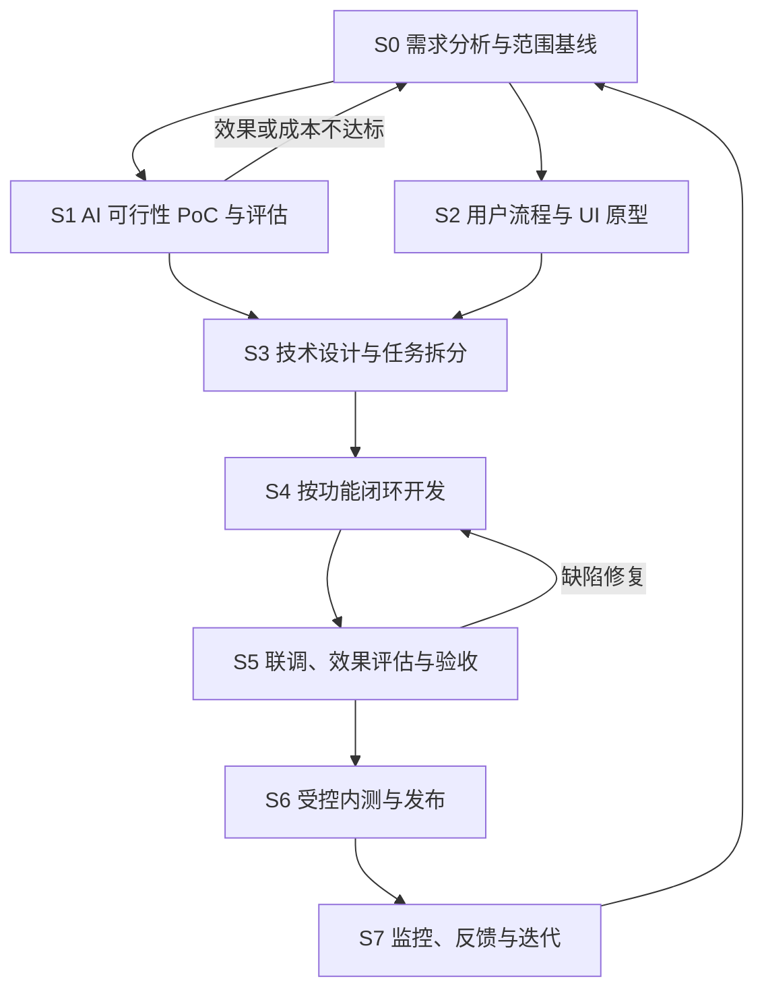

# 项目开发流程

版本：1.0；制定日期：2026-10-22；状态：后续执行约定。

## 1. 流程适用范围

本项目是使用外部生成模型的实时视频应用。工程工作包括产品与体验设计、模型评估、前后端开发及运行维护。首版不自行训练模型，不强行加入 RAG、Agent、微调或 GPU 集群。

以下是为本项目制定的轻量流程，不宣称存在一套适用于所有 AI 项目的强制行业模板。参考依据见[设计复核与调研依据](01-设计复核与调研依据.md)。

S1 与 S2 可并行；PoC 可以包含最小验证代码。没有 PoC 结论时，不冻结生产模型方案或扩展完整业务系统。尚未获得 API 条件时，先做原型、Mock 和契约设计，不把这些工作记作 S1 通过。

## 2. 每个阶段要做什么

| 阶段 | 需要解决的问题 | 必须留下的交付物 | 完成条件 |
| --- | --- | --- | --- |
| S0 需求 | 谁使用、解决什么、首版做多少、如何验收 | 需求基线、正常与异常流程、P0/P1、待决策项 | 每项 P0 有可观察结果；假设和事实分开；未决项标明影响 |
| S1 可行性 | 模型是否适用，目标网络能否连接，效果与费用能否接受 | 样本清单、最小 PoC、实验及账单记录、继续/调整结论 | 核心链路实测；记录失败；具备进入开发的效果、网络和预算依据 |
| S2 UX/UI | 用户如何理解与操作，等待/失败时怎样恢复 | 信息架构、线框、可交互原型、视觉规范、状态表 | 上传到结束可完整走通；取消、拒绝、超时、额度不足均有明确处理 |
| S3 技术设计 | 模块怎样协作、接口和数据如何约束 | 架构/时序、接口契约、数据约束、技术决策、开发任务 | 核心风险有处理方案；任务有依赖、输入输出及验收；接入版本记录清楚 |
| S4 开发 | 怎样逐步交付可运行能力 | 应用代码、必要测试、配置示例、启动说明 | 单个功能闭环可复现；真实与 Mock 模式区分；完成任务有证据 |
| S5 验收 | 功能、媒体资源、真实效果与成本是否达标 | 需求追踪矩阵、测试报告、缺陷及复测记录 | 全部 P0 通过；质量指标达到已确认门槛；无阻塞或高严重度问题 |
| S6 发布 | 谁能访问、费用如何控制、故障如何恢复 | 环境与版本清单、发布记录、回滚步骤、内测反馈入口 | 预发布通过；邀请码与预算限制有效；监控可用；先受控内测 |
| S7 迭代 | 真实使用暴露了什么，下一轮改什么 | 指标与费用复盘、问题分类、下一版需求 | 新需求回到 S0；模型/配置变化完成相应回归 |

阶段检查是工作条件，不要求每一步都向用户重新申请许可。已授权且可逆的文档、原型、开发和验证工作继续推进。只有缺少必要输入或涉及新增付费、公开发布等实际边界时，才提出具体依赖或请求。

## 3. 文档如何维护

| 内容 | 维护位置 | 更新时机 |
| --- | --- | --- |
| 产品定义、FR/NFR、验收目标、费用假设 | 根目录设计主文档 | 范围或指标变化 |
| 页面、线框、交互状态 | 02-需求基线与UI原型.md | 交互调整 |
| 样本、实验方法与真实结论 | 03-AI可行性验证与评估.md；后续 experiments/ | 新实验或模型配置变化 |
| 模块边界、时限、契约细化与决策 | 04-技术设计补充.md | 技术选型或协议变化 |
| 当前任务、实际测试、阻塞与发布记录 | 05-开发任务与验收.md；后续 reports/ | 每个工作包结束 |

现阶段不拆出大量空白文档。接口规模增长后再增加 OpenAPI 文件；数据实现时再加入数据库迁移；正式实验与测试发生后再新增结果文件。目录名列为计划时不代表文件已经存在。

## 4. 单项功能的执行循环

1. **读需求**：写清 FR/NFR 编号、本次范围与不确定项。
2. **检查设计**：找到页面状态、接口、数据及异常处理；缺口先补齐。
3. **拆成可验收任务**：通常控制在一个工作日左右的闭环；更大任务继续拆分。估算是规划，不是固定交期。
4. **实现**：先完成可运行主路径，再完成该任务必须覆盖的异常与清理。
5. **验证**：选用适当的类型检查、构建、逻辑/契约测试、浏览器或实机验证。媒体与真实模型必须有实测。
6. **记录**：写实际命令、环境、结果、证据位置与已知问题；没有执行的检查写“未执行”。
7. **同步**：更新任务、必要文档及版本变更，验证通过后按用户当前授权创建本地 Git 提交，并报告改动与验证结果。

开发的准备条件（DoR）：需求可理解，依赖可获得，验收可执行。开发的完成条件（DoD）：代码可运行、相关验证通过、异常可恢复、资源可清理、配置和文档已同步。仅完成页面或编译通过，不能代表实时试衣功能完成。

## 5. AI 辅助开发的约束

- 给开发工具明确的需求编号、文件范围、验收条件与当前限制，每次推进一个工作包。
- 生成代码后检查依赖版本、权限、异步竞态、密钥边界、费用及资源释放。
- 用 Mock 测试确定性工程行为，用固定样本评估生成效果；两类结果分别记录。
- 将代码版本、模型、SDK、提示模板与评估样本关联。修改其中一项时，检查影响范围。
- 先构建最小完整闭环，再扩展衣橱、登录体系和商业化；变化仍由需求驱动。

## 6. 变更与例外

文案或样式的小修只需更新相关页面和验证结果。新增功能、改变费用或数据路径时，按“原因 → 需求编号 → UI/技术影响 → 测试 → 结论”记录。PoC 不通过时回到范围和技术方案，不继续堆叠功能。

单人可以兼任产品、设计、开发和测试角色，但交付物与检查点仍需留下。原设计的两人五周排期仅保留为历史估算；新的交付时间需根据实际人力、PoC 与账户条件重估。

## 7. Git 与提交规范

本项目使用本地 Git 仓库，主分支为 `main`。首个提交 `6397dcb` 保存复核前的两份 Markdown。暂未配置远程仓库。

**当前授权**：用户于2026-10-22明确允许后续在判断改动适合提交时自行提交。完成相关检查后可以自行暂存和创建规范的本地提交，不需要逐次请求确认；不自动推送、购买、部署或改写历史。此前等待逐次审核的要求不再作为后续提交限制。

提交格式：`<type>(<scope>): <中文说明>`；scope 可省略，使用稳定的模块名称，如 project、workflow、ui、media、session、quota、decart。标准文档类型用 `docs`。

| 类型 | 用途 | 示例 |
| --- | --- | --- |
| feat | 新增可用功能 | `feat(media): 增加摄像头预览与主动关闭` |
| fix | 修复已有行为 | `fix(session): 回收取消授权后返回的相机流` |
| docs | 需求、设计、说明文档 | `docs(workflow): 规范项目开发流程与验收任务` |
| refactor | 保持对外行为的代码重构 | `refactor(session): 统一会话资源清理入口` |
| test | 测试用例与测试支持 | `test(quota): 覆盖并行申请的幂等预留` |
| chore | 仓库与日常维护 | `chore(repo): 配置忽略规则与文本换行` |
| style | 不改变行为的代码格式 | `style(ui): 统一组件代码格式` |
| perf | 性能优化 | `perf(image): 减少换图时的重复解码` |
| build / ci | 构建依赖 / 自动化检查 | `ci(checks): 添加类型检查与构建验证` |
| revert | 撤销已有提交 | `revert: 撤销未通过验证的模型配置调整` |

提交说明写改了什么及具体对象，避免“update”“修改一下”“完成项目”等模糊描述。UI 新能力属于 feat，行为缺陷属于 fix，纯代码格式才是 style。重要变更可在正文附原因、关联任务和验证结果。破坏兼容的变更使用 `!` 或正文注明 BREAKING CHANGE，并写迁移影响。

每次工作先看状态和差异，完成相关验证，显式暂存相关文件，检查暂存内容，再创建本地提交。不要将密钥、本地环境、依赖、构建产物、测试媒体或用户无关改动混入提交。提交后检查 `git status` 与摘要；需要远程协作时再配置仓库和推送，不自动发布远程内容。

小型文档调整可在 main 提交；功能开发优先用 `feat/<主题>`、缺陷修复用 `fix/<主题>` 分支。当前授权允许验证后的本地提交，不默认包含远程推送或公开发布。暂不引入复杂多长期分支体系。
