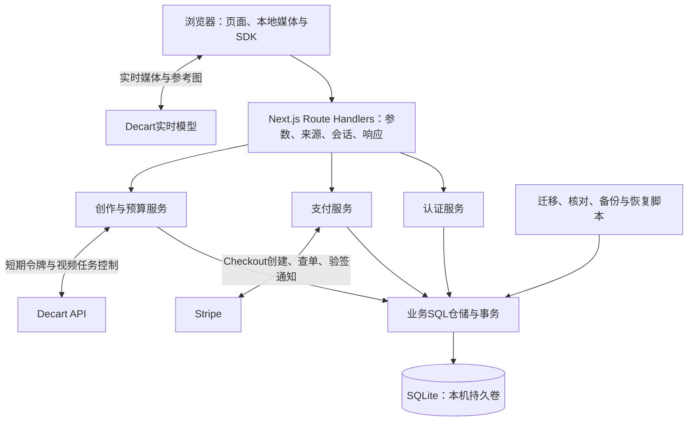

# 映想 SQLite 架构与迁移规划

> 2026-10-24实施更新：已完成本机 FastAPI + SQLite 切流，Next.js 仅同源转发，旧JSON归档。当前运行与本轮实际证据以[迁移验收报告](reports/2026-10-24-FastAPI与SQLite架构迁移.md)及[后端手册](../backend/README.md)为准；下文旧阶段的“未实现”、文件仓储维护及WAL/版本前置条件保留为历史，已由ADR021和本轮执行结果覆盖。
日期：2026-10-24。状态：SQLite数据原则保留；本文的Next.js全栈、better-sqlite3、目录/命令和实施顺序已由[FastAPI完整迁移计划](13-FastAPI后端与SQLite完整迁移计划.md)覆盖。旧方案保留用于追踪决策，不再按本文安装Node数据库驱动。当前尚未拆分后端或迁移运行数据。

关联主文档FR09/10/11/13—16/18/21/23/24、NFR06—09；沿用T14—18/21/23/24，新增T25存储迁移与故障验收。需求编号与验收目标以主文档第26章为准，本文细化实施方式。

## 1. 决策与适用范围

采用**单机部署的Next.js全栈应用 + 本地SQLite持久化**。代码继续统一维护在frontend/；现阶段不拆独立后端，不引入Redis、消息队列或数据库服务器。保留现有用户名密码、HttpOnly会话及外部模型/Stripe服务。

SQLite作为账号、订单、权益、额度预留及任务元数据的统一事实来源；实时媒体仍由浏览器与供应商连接，视频上传/结果按现有服务端鉴权转发。图片、视频、音频、提示词、模型临时令牌、Stripe密钥与完整诊断对象不进数据库。

这是当前规模下的工程选择，不是已验证容量结论。SQLite的WAL支持同机读写并行，但同一时刻仍只有一个写事务；数据库必须位于本机持久磁盘，不能放到网络共享盘，也不适合多个独立容器各自维护副本。官方依据见文末。

## 2. 现状与必须调整的地方

| 现有组件 | 实际持久化 | 下一步职责 |
| --- | --- | --- |
| AccountStore | .cache/accounts/store.json，文件锁+整文件原子替换 | 拆为认证、权益、支付的应用服务与SQL仓储；保持现有API响应兼容 |
| Stripe服务 | 与AccountStore共用订单、事件ID及sandboxGrants | 用唯一约束及同一数据库事务保证入账与发放；继续隔离沙盒权益 |
| StudioGate | .cache/studio内每次申请JSON及观测占位文件 | 迁移签发尝试与观测，和账号权益预留处于同一事务 |
| PromptGate | .cache/prompt/limits.json及访问凭据文件 | 独立场景预算/租约元数据，后续迁移；凭据仍属服务端配置，不导入业务表 |
| VideoJobs | .cache/video-jobs/jobs.json | 后续迁移本人任务、上游任务ID、预算占用及查询节流 |
| 旧PoC | 历史本地批次/账单资料 | 保留只读归档，不转成可消费次数，不清空解锁 |

当前账号读取也经过写文件事务；登录摘要计算在文件锁期间执行；换装申请则分两步写StudioGate与AccountStore。这些边界需要重构，不能仅把JSON字符串改存SQLite单列。

所有服务继续在服务端校验身份、来源、方案和归属。旧/api/v1关闭入口不因数据库接入重新启用；不保留JSON和SQLite两套同时发权益的路径。

## 3. 总体结构



Route Handler只处理HTTP边界，不写SQL；应用服务组织业务与外部API；仓储只接受类型化业务参数，不接受Request/Cookie或完整Stripe对象；映射器仅暴露AccountView/OrderView等既有脱敏结构。一个操作需要多个仓储时，由应用服务显式进入共享数据库事务，不能各开事务伪装原子提交。

建议目录（未来实施时创建）：

```text
frontend/
  src/app/api/                  保持现有同源路由
  src/lib/server/
    auth/                       用户、密码、会话与授权
    entitlements/               发放、预留、确认、核查与查询
    payments/                   固定商品、订单、Stripe适配器与通知
    generation/                 换装、提示词、视频任务及预算编排
    db/
      client.ts                 连接、PRAGMA与进程内复用
      migrations/               有版本号、校验和的SQL
      repositories/             参数化查询与事务操作
  scripts/db/                   初始化、迁移、导入、核对、备份、恢复
  tests/                        临时SQLite文件与故障回归
  .data/yingxiang.sqlite         开发默认位置；实施时加入Git忽略
```

保持同一工程即可，frontend/是现有工程名称，不表示数据库操作在浏览器执行。开发热更新复用连接，服务退出正常关闭；构建导入模块不创建正式库、不执行迁移，数据库仅Node runtime运行。

## 4. 驱动与数据库配置

建议先采用**better-sqlite3 + 参数化SQL + 显式SQL迁移**，暂不加ORM。现有数据关系和关键事务规模较小，直接SQL便于审阅金额核对、条件扣减与唯一约束；TypeScript仓储负责业务返回类型及运行时边界校验。后续关系查询变复杂时再考虑Drizzle，不同时引入两种访问体系。

2026-10-24实际核对：本机Node22.22.0；npm当前better-sqlite3为13.0.3、engines为Node>=22，官方发布页对应版本可访问。**13.0.3为实施候选，尚未安装/验证原生二进制、Next.js打包与部署兼容**；第一工作包需在临时库完成验证后再固定依赖和锁文件。Node22.22.0的node:sqlite模块仍标实验状态，暂不作为首选；不因为内置就宣称稳定性或兼容性已满足。

建议初始化配置：WAL、foreign_keys=ON、synchronous=FULL、busy_timeout初始1000ms。FULL优先保证已付款与已预留数据的耐久性，不将它当作消除硬盘损坏风险的承诺。超时后返回可恢复的503，不无限阻塞；NFR07的业务P95目标保持，不能把1秒等待上限当作达标结果。PRAGMA写入后实际读取核对。

每个进程复用受控连接，不为每个请求建连接。同步SQL保持短小，密码scrypt、网络请求、媒体解析、备份和大批量导入不得占用业务写事务；同步驱动仍会占用事件循环，需通过实际接口压测决定是否要工作线程。

运行时记录sqlite_version()及编译信息；WAL必须使用已修复官方WAL-reset问题的SQLite版本（3.51.3及以后，或明确列出的已修复回补版本），不能只看npm包版本猜测底层版本。实施时根据发行内容与实际查询核对。

## 5. 数据模型与数据库约束

时间统一UTC毫秒整数，API继续输出ISO字符串；不将旧文档PostgreSQL的timestamptz照搬到SQLite。人民币订单用整数分，预算用整数microUSD（1美元=1,000,000），不同币种/单位不混加；已有浮点预留需在导入时以明确规则转换并核对。

### 第一批：账号、支付、权益与换装

| 表 | 核心内容 | 关键约束/索引 |
| --- | --- | --- |
| users | 稳定UUID、规范化用户名、密码摘要/盐/算法参数、状态、创建时间 | username_normalized唯一；不存明文密码 |
| auth_sessions | 会话摘要、user_id、到期时间、撤销时间 | 摘要唯一；user_id/到期索引；只按有效会话查用户 |
| auth_rate_limits | 动作/主体摘要、窗口结束、计数 | 作用域和key唯一；到期索引；失败计数必须提交 |
| orders | 用户、业务幂等key、SKU快照、时长/次数、整数金额、币种、Checkout请求版本/固定参数、状态、Stripe账户/模式/Session、fulfilled_at | (user_id,操作key,模式)唯一；(账户,模式,session_id)唯一；本人/创建时间索引；金额及档位CHECK |
| payment_events | Stripe账户、模式、event_id、最少事件类型/对象ID、处理结果与时间 | (账户,模式,event_id)唯一；只保存最少元数据，不保存完整Webhook正文 |
| entitlement_grants | 用户、场景、15/30/60秒、环境、来源、总发放/预留/已用/撤回数、来源订单或导入key | 来源幂等键唯一；数量非负且预留+已用+撤回<=总发放；账户/场景/档位/环境索引 |
| entitlement_entries | grant、操作类型、数量、业务操作key、原因、时间 | 操作key唯一；流水追加留账；与grant计数同事务更新 |
| usage_attempts | 操作ID、用户、场景、档位、所用grant、签发状态、租约/令牌截止、观测与核查状态 | 操作ID唯一；归属/状态/截止索引；模型临时token不落盘 |
| schema_migrations | SQL版本、校验和与应用时间 | 版本唯一；已应用迁移不可静默修改 |
| migration_imports | 源快照指纹、批次、导入器版本与摘要核对结果 | 源指纹+导入版本唯一；不能重复赠送或重复扣减 |

核心表之间使用外键，账务/订单/流水禁止级联删除。新用户免费权益以稳定来源key确保每账号一次；迁移导入已有用户不走新用户赠送逻辑。暂不引入手机号身份表、管理员网页和短信渠道，避免扩大本轮范围。

环境不能只用一个含糊的test布尔值：订单保存Stripe账户及模式；权益区分`stripe_sandbox`和`real_usage`。现有免费/手工额度虽然用于本机开发，却能调用真实模型，迁移时归入real_usage且保留来源，不能与sandboxGrants合并。未来live代码也不能只按前端字段切换模式。

### 第二批：场景预算与任务

增加budget_campaigns、budget_reservations、video_jobs，将提示词/视频独立预算、最大次数、lease_until、供应商任务ID及状态迁入同一库。它们与实时换装购买次数分开，迁移不自动增加预算或次数。旧PoC无法归属用户的历史批次保持归档，不伪造用户外键。

## 6. 事务与外部调用

**SQLite事务不能跨越Stripe或Decart网络调用。** 采用“短事务预留 → 提交 → 外部调用 → 短事务确认”；数据库只能保证本地原子性，不能保证第三方请求恰好执行一次。better-sqlite3事务内不得使用async/await。

### 6.1 注册与登录

注册前完成输入校验与独立限流计数，scrypt在事务外执行；注册事务插入用户、一次免费grant及会话摘要，用户名冲突整体回滚。登录失败计数先持久化，不能因为随后抛认证错误而被事务回滚；成功登录再写会话。保留Cookie策略及摘要算法，公开部署前另行配置HTTPS与受信Origin。

### 6.2 订单与支付发放

1. 事务预建订单，固定SKU/金额/币种快照及稳定Stripe幂等key；客户端不能传入金额或付款归属。
2. 在事务外创建Checkout，再在短事务绑定Session；网络未知保留待核查状态，同key重试，沿用23小时停止自动重建规则。固定请求版本、幂等参数和API版本，不能因程序重启或发布改文案而改变旧订单重试参数。
3. Webhook原始字节验签，在事务外查Stripe当前Session，核对账户、模式、归属、商品快照及金额/币种。本人查单复用同一业务函数。
4. 写事务内插入事件去重记录、条件设置订单paid/fulfilled_at、插入订单唯一grant与grant流水。全部成功才提交；写失败返回非2xx，让Stripe重试。业务已发放时重复事件或不同事件都不重复加次数。
5. 只有complete且paid可发放；迟到失败/过期不能降低已付款订单。无关事件不发权益；付款回跳不作为依据。

导入的已fulfilled订单必须同时导入对应历史grant，不能只迁订单后等待旧Webhook再次赠送。退款/争议仍未实现，未来需要追加冻结/撤回流水及与已用次数的核查策略；本次建账结构不等于退款能力完成，也不开放live。

### 6.3 换装权益与签发

1. `BEGIN IMMEDIATE`事务重新验证会话，按用户/场景/档位/real_usage选择可用grant；条件更新预留数且校验affected rows，插入唯一usage_attempt及reserve流水，一起提交。
2. 事务外调用Decart。发请求前已经占用权益；令牌取得后短事务将reserved转used，并记录issued及lease/到期元数据。
3. 上游超时、数据库确认失败、进程崩溃或无法确定是否发出的调用，保持待核查与占用，不能仅按超时自动释放；没有供应商可靠幂等/查询证据时，不自动重签。短期令牌不落盘，因此已签发但响应丢失的重试也不得再签一枚。
4. 相机失败、非法输入等在预留前拒绝。客户端ended/error只补观测，不能自动退款/返次数；租约到期仅释放并发占位，不等于释放次数或预算。

### 6.4 后台核对

第一阶段保留受保护的显式查单/运维脚本，不在Next.js请求中挂无人管理的永久定时器。若加入周期对账，使用同机调度器运行有租约的有限批次脚本，仅查询已存在订单/已知供应商任务，不自动重提未知模型调用。需要后台重试量明显增加时再引入独立worker，仍可复用同一工程和数据库。

## 7. 不丢数据的迁移

采用**备份 → 临时库演练 → 停写快照 → 导入核对 → 一次切换**，不双写。导入脚本默认dry-run，不发送短信、支付或模型请求。

| 来源 | 导入规则 |
| --- | --- |
| users | 保留UUID、规范化用户名、盐/摘要及scrypt参数；不重新注册或重置密码 |
| sessions | 保留有效会话摘要和到期时间；过期记录按既有规则处理，不延长会话、不生成新Cookie |
| quotas/durationQuotas | 按现有quota函数的有效值、默认值、上限与档位映射总授权；默认15秒1次，不把默认值叠加在手工总额上 |
| attempts | 保留全部ID/时间/state/outcome；缺失durationSec按15秒；review保留占用并核查，不认定已出画 |
| StudioGate记录 | 依据attemptId关联账号记录，将签发状态和观测合并，不把两份同ID记录计成两次；有供应商记录但账号未扣减等异常先列差异并阻止切换 |
| paymentOrders/paymentEvents | 保留所有创建未知/待付款/失败/过期/paid状态、Session及事件去重信息；旧事件无完整关联时记录为legacy，不猜测对象；禁止live/sandbox串账 |
| sandboxGrants | 以已fulfilled订单重建每订单唯一grant，并与原聚合值精确比对；不能同时再把聚合值赠送一遍。不匹配时停止切换并生成脱敏差异 |
| limits | 保留尚未结束的限流窗口与计数，不通过迁移绕过防刷 |
| 视频/提示词账本 | 第二批保留任务ID、用户归属、unknown/issued、供应商任务ID、预算预留和租约；缺失文件与存在但为空区分，不因缺失自动解锁 |

若出现历史使用大于授权、重复用户名/ID、失联归属、冲突Session或未识别字段，完整源快照保留，导入器报错/列差异，不能静默丢记录、改ID或把余额调成更大值凑通过。

迁移演练与核对不打印密码摘要、Cookie、密钥或完整JSON。对每用户/时长核对总授权、占用/已用、剩余；对订单核对状态、金额与发放；unknown数量及预算占用不得减少。原有有效scrypt密码和会话须经测试确认可继续使用。

正式切换前，进入维护期停止账号写入、签发和订单创建，等待现有业务窗口结束；备份所有源文件后获取最终指纹。Webhook不能丢弃：维护时返回503，依赖Stripe重试并在切换后对已知订单查单。导入后的文件和验证均完成才启动SQL版；禁止多个Next进程在启动时竞争运行迁移。

回退仅在SQLite尚无新业务写入时可直接恢复旧版与原JSON。一旦接收新订单、权益或签发，不可直接切回旧快照；先停写，使用经过验证的反向导出/逐笔核对，或保持维护并向前修复。备份恢复后重新核对Stripe已付款订单及供应商未知使用，不能仅按旧库恢复可用次数。

## 8. 部署、备份与可观测性

- 初期单机、单个常驻Node应用进程；HTTPS反向代理是未来部署项。SQLite落本机持久卷，发布换代码不能覆盖数据。开发默认.data/，生产用YINGXIANG_DATA_DIR指向挂载目录。不可放public/、构建输出或会被清理的.cache；生产不依赖临时Serverless磁盘。
- 单机进程策略不等于永远只能一个连接；工具脚本/备份可能另开连接，必须有busy处理和版本兼容。跨机器扩容时再评估PostgreSQL，不让多个主机通过共享盘并发写同一SQLite。
- 备份使用SQLite在线backup API或经验证的一致性快照；不能在运行时只复制.sqlite主文件而忽略WAL。备份目录限权、异机副本需加密，敏感留存策略单独确认；不上传备份到仓库。
- 提议运维目标：每天自动备份、每次迁移前备份、每月至少一次恢复演练；目标RPO不超过24小时、RTO不超过1小时，均待实际恢复测试，不能用于承诺金融数据零损失。付款可向Stripe核对，模型未知占用仍须保守保留。
- readiness检查能否打开正确schema及基本查询；失败不自动初始化空库，不向外暴露路径/SQL。记录写事务耗时、SQLITE_BUSY、磁盘空间、WAL大小、待核查订单/使用数量；日志仅白名单元数据。
- SQLite默认不提供静态数据加密；文件权限与磁盘/备份加密按部署环境落实。会话和密码仍只存摘要，长期密钥仍仅在服务端配置；数据库接入不自动改变现有本机Origin、CSRF、手机号或公开防刷边界。

## 9. 开发顺序与验收

| 工作包 | 交付范围 | 核心验收 |
| --- | --- | --- |
| DB01 驱动与迁移底座 | 临时库兼容、固定依赖、连接/PRAGMA、schema版本、备份恢复 | Node/Windows/Next生产构建；SQLite版本修复要求；真实文件锁/磁盘错误处理 |
| DB02 账号与账本仓储 | 用户/会话/限流/权益/订单SQL仓储，保留API脱敏结构 | 注册唯一/一次免费；失败限流持久化；旧摘要登录；未知占用与沙盒隔离 |
| DB03 支付与换装事务 | 支付统一发放函数、账户/签发同库预留、网络事务拆分 | 重复/乱序/并行Webhook与查单只发一次；两连接争用最后一次仅一方成功；崩溃不额外签发 |
| DB04 导入与受控切换 | dry-run、指纹、差异、维护期最终导入、前后核对、恢复步骤 | 原文件不变；二次导入不增减权益；有效登录/历史/手工配额/两笔沙盒权益保留；异常阻止切换 |
| DB05 其他场景元数据 | 视频任务及提示词预算迁入同库，移除对应运行文件仓储 | 既有issued/unknown/费用预留/租约/上游任务归属不减少；独立开关保持关闭 |
| DB06 运维与回归 | readiness、备份/恢复脚本、脱敏指标、文档 | 数据不可HTTP访问；磁盘满/写锁/恢复演练；类型、必要回归、生产构建及HTTP检查 |

DB01—04先形成账号/订单/权益闭环，DB05在新场景重新测试前完成；中间阶段明确只有未迁移场景仍以原文件为事实来源，不声称所有记录已统一。无需为了同名目录一次重写前端。

T25的关键故障注入：reserve提交后进程退出、供应商成功但确认前退出、paid发放中途写失败、Webhook重放/查单竞态、数据库缺失/损坏/只读/磁盘满、两进程竞争余额、重复导入、备份恢复后的旧事件重投。用临时库与供应商替身测试，不触发真实AI或真实支付；既有114项测试为迁移前证据，不是SQLite通过证据。

## 10. 本轮实际交付与边界

完成现有代码/文档盘点、官方SQLite与驱动文档核对、架构/表约束/事务/迁移/部署/任务规划；同步主基线和相关文档。只变更Markdown，不安装数据库驱动、不创建实际数据库、不停服务或改配置、不迁移账户、不重新发送支付/AI请求，不自动提交Git。数据库性能、驱动兼容、导入及恢复均未执行，进入DB01后才产生验收证据。

## 11. 官方依据

- [SQLite适用场景](https://www.sqlite.org/whentouse.html)：单机网站及改用客户端/服务端数据库的条件；本文不使用通用流量数字承诺本项目容量。
- [SQLite WAL](https://www.sqlite.org/wal.html)：同机共享、单写者、checkpoint及WAL-reset修复版本。
- [SQLite PRAGMA](https://www.sqlite.org/pragma.html)：foreign_keys、busy_timeout及synchronous配置。
- [SQLite备份API](https://www.sqlite.org/backup.html)：在线一致性备份。
- [better-sqlite3 API](https://github.com/WiseLibs/better-sqlite3/blob/master/docs/api.md)：事务回滚、immediate、禁止异步事务及backup；本轮通过Context7读取官方仓库文档。
- [better-sqlite3性能与耐久性](https://github.com/WiseLibs/better-sqlite3/blob/master/docs/performance.md)：WAL的NORMAL默认值及FULL覆盖。
- [better-sqlite3 v13.0.3](https://github.com/WiseLibs/better-sqlite3/releases/tag/v13.0.3)：本轮候选版本，未安装验证。
- [Node22.22.0 SQLite文档](https://nodejs.org/download/release/v22.22.0/docs/api/sqlite.html)：运行环境对应模块状态与API。
