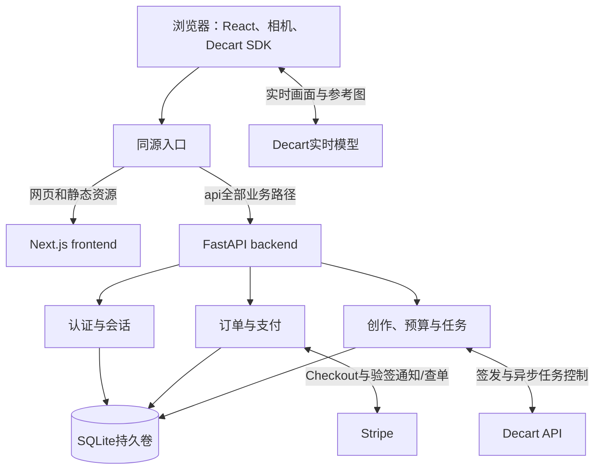

# 映想 FastAPI 后端与 SQLite 完整迁移计划

> 2026-10-24实施更新：已完成本机 FastAPI + SQLite 切流，Next.js 仅同源转发，旧JSON归档。当前运行与本轮实际证据以[迁移验收报告](reports/2026-10-24-FastAPI与SQLite架构迁移.md)及[后端手册](../backend/README.md)为准；下文旧阶段的“未实现”、文件仓储维护及WAL/版本前置条件保留为历史，已由ADR021和本轮执行结果覆盖。
最初计划日期：2026-10-24。状态：原计划已在本机实施，实际切流/配置/验证见顶部实施更新和迁移报告。本文第14节记录的是编写计划时的交付，后续迁移不扩大公开发布、真实收款或AI测试授权。

主基线：设计主文档第27章。关联FR09/10/11/13—16/18/21/23/24、NFR06—09、T14—18/21/23/24/25及新增T26。本文覆盖12中Next.js全栈/better-sqlite3/SQL脚本的执行选型；SQLite单机、权益账本、保守未知占用和无损导入原则保留。

## 1. 目标、范围与完成定义

目标是**保留Next.js/React前端，将现有业务API迁为Python FastAPI独立后端，并使用SQLAlchemy/Alembic管理SQLite**。前后端同仓库、同机器、两个常驻进程，浏览器仍用同源/api访问；数据库和长期密钥仅归后端。

本次规划不改为Vue、不重做UI、不改变Decart模型/提示模板/计费路径、不增加手机号/JWT/短信、不引入Redis/Celery/微服务，不开放Stripe live。此前Fastify只是比较候选，未实施；现在以后端FastAPI为目标。

完成迁移必须同时满足：旧账号/密码/有效会话可继续使用；原HTTP合同和页面流程兼容；订单/通知/权益及模型尝试不重复发放或消耗；所有现有场景元数据和风险占用保留；SQLite备份恢复通过；所有业务写请求仅由一个后端处理；旧Next.js业务实现移除或明确拒绝；测试、构建、HTTP及浏览器回归有实际证据。写完本文不能将这些状态标为通过。

## 2. 技术栈与版本策略

| 层次 | 选型 | 说明 |
| --- | --- | --- |
| 网页/媒体 | 现有Next.js16.4.2、React19.3.1、TypeScript5.9.3、CSS Modules | 保留浏览器SDK0.2.12及媒体生命周期；不用Python接管WebRTC |
| Python运行时 | Python3.13系列，M01固定补丁版与发行环境 | 必须验证实际链接的SQLite及OpenSSL/scrypt，不只检查Python版本 |
| API/服务进程 | FastAPI + Uvicorn，初期1个worker | 独立监听回环8788；不启动多个后台消费进程 |
| 参数/DTO | Pydantic2 | 请求严格类型、禁止多余字段；保持现有JSON字段名与错误包装 |
| 数据访问 | SQLAlchemy2.1同步Engine/Session + Python sqlite3驱动 | 采用2.x风格模型/事务；不叠加SQLModel/aiosqlite |
| 数据迁移 | Alembic | 有序revision、约束命名、SQLite batch迁移；禁止启动时自动create_all掩盖缺失迁移 |
| 数据库 | 本机SQLite，WAL/FULL/外键 | 单写者；仅后端运行账户访问持久目录 |
| 外部HTTP | HTTPX AsyncClient | 生命周期复用，明确超时/响应上限/不跟随重定向；模型生成POST不自动重试 |
| 支付 | 官方stripe-python，实例StripeClient | 显式保留API2026-09-30.endive；此次不顺便升级业务API版本 |
| 验证 | pytest + HTTPX/ASGI测试，沿用前端Node测试与浏览器检查 | 真文件并发/进程故障测试不能仅使用内存SQLite |
| 依赖管理 | 后端venv + pip；前端继续npm与原锁文件 | 不引入Node工作区；后端直接/间接依赖及哈希写入requirements.lock.txt |

2026-10-24只读核对官方PyPI元数据：FastAPI0.161.1、Pydantic2.14.1、SQLAlchemy2.1.6、Alembic1.20.1、Uvicorn0.54.0、HTTPX0.28.1、stripe16.0.0、pytest9.1.1、python-multipart0.0.32。以上是**安装验证候选版本**，尚未解析兼容依赖或安装；M01通过后固定完整锁文件，不能直接把候选查询当成安装通过。

本机当前Python3.12.6、sqlite3链接3.45.3，未满足既定WAL-reset修复要求。M01必须选择实际SQLite>=3.51.3或官方明确修复的回补版本（如3.50.7/3.44.6）的运行环境，并记录sqlite3.sqlite_version、平台与构建来源；不合格阻止切换。Python升级不自动保证SQLite升级，不静默替换系统DLL，也不为此自动使用未知来源驱动。

## 3. 目标架构与目录



开发时仍访问127.0.0.1:8787，通过Next.js精确代理/api到8788。未来部署由同机反向代理直接将/api交给FastAPI、页面交给Next.js，Webhook不必经过页面进程；两个内部端口均不直接对公网开放。部署配置实施时核对官方文档，不在本轮安装网关。

```text
frontend/                         保留现有工程、资源、测试、npm锁文件
backend/                          后续M01创建
  app/
    main.py                       应用工厂、生命周期
    api/                          路由、请求/响应适配
    core/                         配置、认证边界、错误、日志白名单
    services/                     auth、entitlements、payments、generation
    repositories/                 SQLAlchemy查询及事务操作
    models/                       数据库实体
    schemas/                      Pydantic公开DTO
    integrations/                 stripe、decart适配器
    db/                           engine、Session、事务与健康检查
  migrations/                     Alembic revision与环境
  scripts/                        导入、核对、备份、恢复、有限批次查单
  tests/                          合同、业务、迁移、并发与故障回归
  data/                           开发默认持久目录，不提交Git
  pyproject.toml                  工具/项目元数据
  requirements.in
  requirements.lock.txt
  .env.example                    无真实值的示例
docs/api/                         导出的OpenAPI合同与兼容记录
```

数据库实体不能直接充当接口响应。应用服务不依赖FastAPI Request；HTTP层解析身份、来源、DTO后传入服务。仓储不接触Cookie/完整SDK对象；一次业务事务由服务统一提交，不让每个仓储分别commit。

前端继续相对/api调用，不新增NEXT_PUBLIC_SECRET或向前端下放数据库连接。前端需要的时长/价格等为公开展示数据，后端仍独立做最终校验；OpenAPI导出生成前端类型，CI检测漂移，不同时手工维护两套权威合同。

## 4. 接口迁移清单与兼容规则

| 当前合同 | 新后端职责 | 验收关联 |
| --- | --- | --- |
| GET /api/account/me | 本人资料、按档权益、最近使用记录，匿名返回既有空态 | T14/15/17/21/26 |
| POST /api/account/register、login、logout | 原用户名/密码规则、Cookie签发/撤销、持久限流 | T14/17/26 |
| GET /api/payments/status、orders | 沙盒门禁、本人最近50单及独立测试权益 | T16/18/26 |
| POST /api/payments/checkout、reconcile | 固定SKU、归属、请求幂等、已知订单查单恢复 | T16/26 |
| POST /api/payments/webhook | 原始字节验签、当前Session查单、原子去重发放 | T16/25/26 |
| GET /api/studio/status；POST token、observation | 登录/时长/云端确认、来源和nonce、权益预留、Decart权限约束、脱敏观测 | T04/13/15/17/21/25/26 |
| GET /api/prompt/status；POST token | 原独立预算、Lucy2.5纯文字15秒签发与保守租约；默认关闭 | T24/25/26 |
| GET/POST /api/video/jobs；GET /{id}、/{id}/content | 上传校验、归属、任务状态、结果代理/下载及独立预算；默认关闭 | T23/25/26 |
| GET /api/v1/config、health | 保持旧公开合同；readiness另设内部端点，不能把storageReady历史值未经约定改成新语义 | T01/26 |
| POST旧/api/v1/access/redeem、sessions及/{id}/token、heartbeat、end | 保持503 SERVICE_DISABLED，不能因拆分开放旧入口 | T14/26 |
| 不存在的路径/方法 | 保持404/405及既有安全响应，不自动跳转相似路径 | T26 |

M02从实际路由/测试生成方法、路径、body上限、状态码、字段、headers、Cookie和副作用清单；本表是分组索引，不替代每条合同快照。Pydantic保持camelCase别名、null与省略字段差异、UTC ISO字符串；全局请求验证/业务/未知异常映射为既有`{error:{code,message,retryable},requestId}`，不能回落为FastAPI默认422/detail或回显输入。禁用路径尾斜杠自动307跳转；非JSON仍按原415/400语义处理。

保留Cache-Control:no-store、nosniff及下载Content-Disposition/Cross-Origin-Resource-Policy。鉴权/来源/参数检查先后顺序影响401/403/503，应以旧合同断言为准。前端状态包括登录失效、余额不足、unknown、待付款、paid、过期、数据库不可用与维护；展示错误时不回显原始上游对象。

## 5. 登录、Cookie与代理安全

### 5.1 旧密码兼容

现有Node scrypt为N=16384、r=8、p=1、dkLen=64、maxmem=64MiB；salt字段为randomBytes(16)转hex字符串，Node传给scrypt的是**该字符串的UTF-8字节**。Python应按相同字节语义使用hashlib.scrypt，不能bytes.fromhex(salt)。摘要为hex，使用hmac.compare_digest等常量时间比较。

用户名继续ASCII字母/数字/下划线、3—24位、转小写；密码不裁剪、不做Unicode归一化。现有JS长度是UTF-16 code unit，Python字符计数不同，M02要以ASCII/中文/非BMP等跨语言固定样本验证长度和UTF-8编码语义，再确定兼容辅助函数。保留算法参数列，不在此次迁移强制重置密码或换算法；不存在用户仍走等价耗时校验，防止明显的账号枚举差异。

scrypt在受限线程池执行，不能阻塞async事件循环或持有SQL写锁；失败登录计数必须独立提交，不能被随后抛出的认证错误回滚。

### 5.2 有效会话与来源

保留yingxiang_session Cookie名称、HttpOnly、SameSite=Lax、Path=/、7天有效期；HTTPS部署加Secure，本机HTTP维持现有例外。不增加Domain或将会话移到localStorage/JWT。旧会话hash=SHA256(原64位hex token字符串的UTF-8字节)，不能先hex解码再摘要；导入原hash和expiresAt，不延长有效期。

身份/会话在FastAPI重新验证，不能信任前端传来的userId。副作用请求继续严格Origin白名单及sec-fetch-site检查，读取接口保持当前允许无Origin的语义。替换localOrigin对内部Host的硬编码，外部可信站点由显式PUBLIC_ORIGIN/ALLOWED_ORIGINS配置；Checkout回跳及Decart allowedOrigins均用校验后的公共Origin。

代理必须保留Cookie/Set-Cookie、Origin、Content-Type及请求体字节；转发头只接受受信回环代理，不能配置任意trust proxy或信任客户端伪造Host。生产仍同源，不默认打开通配CORS。Webhook不依赖浏览器Origin/Cookie，独立按Stripe签名/账户/模式验证。现有场景nonce保持固定本机安全边界，切换时从旧access文件受控迁移，不借换后端自动放宽权限。

## 6. SQLite与事务设计

### 6.1 表、类型与约束

沿用12的数据实体：users、auth_sessions、auth_rate_limits、orders、payment_events、entitlement_grants、entitlement_entries、usage_attempts、budget_campaigns、budget_reservations、video_jobs、migration_imports；schema版本改由alembic_version管理，不再引入独立Node schema_migrations运行器。数据库状态枚举使用CHECK及有名约束；用户/会话/订单/Session/事件/业务操作key的唯一约束和外键必须由数据库执行。

时间存UTC毫秒整数，API按原ISO格式输出；人民币订单存整数分，预算存整数microUSD。禁止浮点累加或CNY/USD混加。来源为free/manual/paid/legacy等，环境明确区分stripe_sandbox与real_usage；后者可能在本机开发调用真实模型，因此不是简单的“开发环境全算sandbox”。

同一个grant维护total/reserved/used/revoked计数，available由差额计算；数量非负及reserved+used+revoked<=total。每次变化同时追加entitlement_entries流水，业务操作key唯一，可核对重建。已使用/风险占用不因lease到期自动变成可用。历史使用超授权等异常不强行凑平，导入阶段阻止切换并列差异。

### 6.2 连接与执行模式

同步SQLAlchemy适合当前短事务；async入口读取有界请求体后，将每个完整数据库操作交给线程池执行，操作内创建/关闭Session。**同一Session不跨并发任务/线程复用**，也不带着事务await网络；全局只复用Engine和HTTPX客户端。check_same_thread=False仅允许驱动跨线程使用，不提供事务安全或提升SQLite写并发。

每条新连接设置/核对foreign_keys=ON、synchronous=FULL、busy_timeout初始1000ms；初始化时设置WAL，readiness确认schema revision及运行SQLite版本。采用SQLAlchemy文档的显式BEGIN控制机制，关键写单元使用BEGIN IMMEDIATE，普通读取正常短事务；M01证明与Session/autobegin/savepoint组合的行为，不同时叠加多套autocommit策略。锁超时返回受控503，不无限重试；接口P95目标仍按NFR07实际测量。

Alembic迁移由运维命令单独执行，业务启动不得隐式建空表/降级/并行迁移。SQLite表重建的batch迁移必须验证数据/外键/索引/CHECK和事务回滚，不能直接上线autogenerate输出。首次无库只有显式初始化命令允许创建，运行库丢失或revision不匹配则失败关闭。

### 6.3 关键业务事务

| 操作 | 短事务内 | 事务外/结果未知 |
| --- | --- | --- |
| 注册 | 用户、一次免费grant/流水、会话一起提交 | scrypt与输入校验在外；用户名冲突回滚，不再送一次 |
| Checkout创建 | 固定订单快照、操作key/Stripe幂等key持久化；返回后再绑定Session | Stripe调用在外；未知保持creating，同参数/key重试，23小时后停止重建 |
| paid处理 | 核对后插事件去重、条件更新paid/fulfilled、唯一grant/流水一起提交 | 验签及Stripe查Session在外；事务失败返回非2xx，不先标processed |
| 实时签发 | 原子验证/预留real_usage次数、创建唯一attempt及流水 | Decart调用在外；成功后确认used，未知继续占用、不自动再签 |
| 提示词/视频 | 独立活动预算、次数、任务/attempt及租约原子预留 | 不跨场景借额度；生成POST未知不重提，查询/下载可有限重读 |

## 7. Stripe Python移植

保持九个既有SKU、人民币分价格、一次性payment模式、动态支付方式、Adaptive Pricing关闭、正式购买关闭。不改变已验证的回跳路径、账户校验、metadata、client_reference_id和幂等key。StripeClient明确API2026-09-30.endive；SDK默认API不能随语言更换而漂移。迁移不等于微信/支付宝或商户资格已通过。

原始Webhook字节以流式限长方式读取（现上限262144字节），调用官方签名验证，保留时间容差；不能先解析JSON再序列化验签。四类checkout.session事件与本人查单复用同一核对/发放服务；核对mode/payment_status/status/livemode/账户/金额/币种/归属及Session唯一性，complete且paid才发放。live key/event和Connect事件继续拒绝。

跨语言重试是重点：已有creating订单的Checkout参数必须逐字段与Node一致，包括商品名、metadata、数量、API版本和integration_identifier。当前字母后缀来自订单ID的SHA256前8字节逐字节mod26+97，必须保留该算法及前缀；不能改用Python hash、随机值或SDK默认值。导入应保存请求快照/模板版本；改变旧请求前先人工核对，不通过换key绕过Stripe参数冲突。

迁移期间仅配置服务端测试key和当前监听器whsec；不打印/提交密钥，不代用户扩大key权限。通知地址保持/api/payments/webhook时CLI无需换公共地址，但代理、路由和验签必须重新验证；端点/监听器变更时重新核对签名密钥。成功回跳不直接发放，恢复已知订单也不能新建一个付款。

## 8. Decart与媒体边界

浏览器保留@decartai/sdk0.2.12、DecartRealtime、VTON/提示词适配器和媒体清理，不引入Python实时视频SDK。FastAPI仅复刻现有固定HTTP令牌/任务控制：上游域名/路径、模型、请求头、TTL10秒、15/30/60秒maxSessionDuration、权限/来源响应复核、超时和不跟重定向策略保持；不记录临时token。

unknown、issued、finished、使用state/outcome与客户端观测是不同维度，不能因为迁移合并为success。进程在上游成功、数据库确认前退出时仍保守占用；客户端ended/error不作为账单或返次数依据。提示词1次issued及既有$0.30预留保持，真实场景开关/测试预算不能因启动新服务自动恢复。

**视频上传不直接照搬FastAPI UploadFile默认行为**：其spooled文件可能转临时磁盘，现有边界是仅内存。计划用有总字节/时间/并发上限的Request.stream，交给无临时文件回调的multipart解析器，在有限内存中验证/转发。候选python-multipart须用临时目录监测证明没有磁盘写入；不能以bytes参数名推定框架内部不落盘。

保留视频<=25MB、参考图<=10MB和既有整体包体上限、最多两个文件及固定字段、MP4无音轨/H.264/时长和图像签名校验。纯解析代码移植到Python并用现有合成素材/异常样本交叉回归；不以MIME或文件扩展名代替检查。代理不转换multipart/压缩Webhook体；开发代理路径需专门验证10MB以上素材，Next proxy缓冲设置不等同于已解决所有大包体限制。

结果使用HTTPX流与StreamingResponse，异常/取消时关闭上游连接；保持本人归属、24小时访问窗口、固定上游地址和下载文件名，不跟随用户提供URL。上传/下载不落盘、不输出原文件名/媒体；内存并发上限通过受控503/429保护，不排队存到磁盘。

## 9. 无损导入与核对

导入以**最终停写快照**为唯一输入；M03—M05只对临时目录/合成或受控只读副本演练。Python不在过渡期接管并写真实JSON，不运行Node/Python双写，不向两个实现同时镜像任何生成/支付/注册请求。

| 来源 | 必须保留/验证 |
| --- | --- |
| accounts/store.json | 用户UUID、盐/摘要/算法、有效session hash/到期、未到期限流、总quota/durationQuotas、attempt及支付记录 |
| 默认与手工额度 | 复刻旧quota()有效值/默认/上限语义；quotas为总量不是额外赠送，不能再叠加默认1次 |
| attempts及studio/*.json | 按attemptId合并同一次使用与签发/观测，不计两次；缺duration按15秒；未知/无归属/冲突先报差异 |
| paymentOrders/events | 原订单ID、请求ID、所有状态、金额/币种、Session/fulfilled、账户/环境及去重ID；旧事件信息不足标legacy，不虚构关联 |
| sandboxGrants | 从fulfilled订单恢复每订单唯一grant，与原聚合精确比对；聚合值不能再赠送一遍 |
| prompt/limits.json | attempts、issued/unknown、lease与已预留microUSD不减少，不重置有限次数 |
| video-jobs/jobs.json | 任务ID、用户归属、供应商ID、状态/到期/节流时间及预算占用，不把过期当退款 |
| access与旧PoC | 访问凭据作为受保护配置迁移；旧PoC文件保留归档，不导入可消费权益或删文件解锁 |

导入批次记录源文件清单/指纹、导入器版本、源键到新主键映射和核对摘要，幂等唯一键阻止重复导入。未知字段、缺失与空文件、重复用户名/ID、同Session多订单、使用大于授权、孤立任务必须显式处理：原始快照完整保留，失败时目标库回滚/隔离，不静默丢弃或调整更大余额。

比较每用户每档总授权、reserved/used/remaining，全部订单状态和整数金额、事件去重集合、两笔沙盒历史权益（15秒5次及60秒10次），全部模型unknown/预算/租约；这些历史值是核对样本，不硬编码成未来用户规则。差异报告只含必要ID/计数/差异类别，不含盐/摘要、Cookie、密钥或完整原始对象。

## 10. 分阶段实施与提交计划

| 阶段 | 实施内容/依赖 | 完成关卡 | 建议提交 |
| --- | --- | --- | --- |
| M01 环境与骨架 | 建backend、隔离venv/锁文件、应用工厂/配置、受控错误/健康；先解决Python/SQLite版本 | 干净环境重建；sqlite/scrypt/事务行为检查；无密钥也能跑隔离测试 | chore(backend) |
| M02 合同与适配层 | 枚举现有API、Pydantic DTO/错误/headers/来源/Cookie；导出OpenAPI；线程池与HTTP客户端 | 同一固定fixture对比Node/Python请求响应；无外部费用；未验证接口继续留在旧运行版本 | feat(api) |
| M03 认证/支付移植 | 独立测试仓储移植账号/会话/限流、固定商品及Stripe服务，生成跨语言密码/幂等fixture | 旧密码/会话fixture登录、paid只发一次、未知创建参数一致；替身上游全通过 | feat(account)、feat(payment) |
| M04 创作API移植 | 换装/提示词/视频控制与纯媒体解析移植；保留独立开关/预算 | 状态/次数/权限/取消/上游未知与包体边界对齐，不启真实模型 | feat(generation) |
| M05 SQLite持久化 | Alembic首版表、SQL仓储、条件更新/唯一约束/事务、导入dry-run/核对/备份恢复 | 临时文件两连接/两进程及崩溃回归；完整导入演练；旧源不变、二次导入不增减权益 | feat(storage)、test(migration) |
| M06 同源集成预演 | 在独立测试环境将/api全路径交给FastAPI；前端页面不重做，验证代理/错误/上传/通知 | API合同、六页/资源、Cookie、非法Origin、伪造转发头、真SDK本地签名重放、无媒体落盘 | refactor(api)、test(integration) |
| M07 停写导入与切流 | M01—06均通过后执行第11节清单；修改运行配置和同源路由，只保留一个写后端 | 最终指纹/数据核对、readiness、本人查询通过；不能丢Webhook或放大权益 | chore(migration) |
| M08 清理与验收 | 验证期后移除Next业务代码/Node Stripe依赖/旧文件运行器，清理重复后端测试，保留归档 | 前端无长期密钥/DB/服务端业务导入，旧旁路拒绝；备份恢复和运行手册完整 | refactor(frontend)、docs(project) |

这些是验收阶段，不承诺未经估算的工期。M03/M04允许内部临时仓储适配以隔离语言移植，不对真实JSON写入；M05完成前不得接入当前运行流量。DB01—06旧工作包映射到M01/05/07/08及相关移植阶段，不能重复记完成。

每个提交包含本功能必要测试及说明，类型/合同破坏前先更新依赖顺序；中间提交应可构建。功能切换使用明确后端路由开关，故障时不能自动fallback到旧写接口。旧业务代码可暂留用于回退，但不能同时处理注册、支付和签发。

## 11. 切流操作清单与回退

执行本节前必须有经过演练的备份、维护页、单实例启动脚本及配置校验。真实模型/实际付费测试仍需另批预算，不因迁移得到授权。

1. **冻结变更**：记录Git版本、前后端配置名/开关、Stripe监听器/账户模式、源目录与目标绝对路径。不开相机、不签新token、不新建付款；视频/提示词保持关闭。
2. **进入维护**：停止注册、登录写入、签发、订单创建和任务提交；等待现有连接窗口及在途请求结束。旧账号GET也会写文件，最终快照期必须停止旧应用/全部源写入；不能仅在UI禁用按钮。
3. **保留回调重试**：临时Webhook返回503而非200丢弃或307改地址；已有Checkout仍可能完成付款，记入切换后待查单集合。保持签名密钥和路径明确，不终止监听后假定事件不存在。
4. **封存源快照**：无旧写进程后复制全部相关源文件到限权目录，生成指纹。未结束/残留锁先核实进程，不直接删锁和账本。保留当前.env本地副本，文件不提交。
5. **建立目标库**：显式执行Alembic升级；导入最终快照，运行完整核对、foreign_key_check/integrity_check及版本/PRAGMA验证。任何差异阻止启用；不把部分导入库留成可读写生产库。
6. **切后端**：停止旧业务路由，启动单worker FastAPI；将/api精确交给它。后端缺失时返回维护/503，不自动走旧Next路由。验证Cookie/Origin/正确数据库路径，确认只有一个写事实来源。
7. **补通知/查单**：恢复Webhook投递，针对本地已知待付款/creating订单重新核对；同一Session只能发一次。未知Decart调用不因恢复而重提，先保留核查状态。
8. **只读核验后开放写入**：本人账户/订单/权益/任务历史及匿名隔离检查无误，再退出维护。使用测试账号/隔离上游验证注册及服务行为，真实AI门禁不自动打开。
9. **观察与收尾**：记录维护起止、导入核对、待核查列表及异常；完成备份/恢复演练。清理旧代码另批提交，保留历史数据和可重建版本。

回退界限：新后端尚无业务写入时，可停FastAPI、恢复旧代码/原JSON并重新核对维护期付款。新库已接受订单/注册/权益/签发后，**禁止直接恢复旧JSON快照**；必须先停写、保留新库及增量，向前修复或使用经过演练的反向导出/逐笔对账。不能将Alembic downgrade当作数据回退；首次生产切流前若没有可靠增量回退方案，就选择维护并向前修复，不自动降级。

SQLite在线备份用sqlite3备份API或验证过的一致性快照，不在运行时只复制主文件忽略WAL。恢复后对Stripe已知付款补查、模型未知占用保守保留；目标RPO<=24小时/RTO<=1小时仅是运维提议，实际测试前不得承诺。所有备份限权，异机副本需加密，不进入public/或Git。

## 12. 配置、部署与运维边界

前端只保留Node/页面配置和服务端内部API目标；后端.env负责DECART_API_KEY、STRIPE_SECRET_KEY/WEBHOOK_SECRET/EXPECTED_ACCOUNT_ID、各场景开关/预算、PUBLIC_ORIGIN/ALLOWED_ORIGINS、DATA_DIR。从现frontend/.env.local受控迁移到backend/.env，核对后只由后端读取；当前阶段不复制或修改真实密钥。路径与配置加载不依赖随机工作目录，避免启动时悄悄创建第二份库。

前端npm仍只在frontend/执行，Python/venv/pip/Alembic命令在backend/执行，根目录不增加npm workspace。M01更新AGENTS.md的工程归属说明、README及忽略规则：backend/.venv、data、SQLite/WAL/SHM、备份和Python缓存不可提交，前后端锁文件与无密钥示例可以提交。未实施前仍遵守现有工作区约定。

初期单机、一个Uvicorn业务worker；开发reload不用于运行切流。前后端分别做liveness/readiness与受控重启；数据库升级/导入/备份是显式脚本，不放入每个worker的startup。不用FastAPI BackgroundTasks承担必须持久完成的付款发放或模型重试；后续有限批次对账由同机调度运行、有租约和上限，新增worker另行设计。

日志沿用白名单，禁打印请求body、密码/盐/摘要、Cookie/Authorization、nonce、模型token、媒体、完整Stripe/HTTPX错误对象。记录业务码、requestId、短事务耗时、锁冲突、WAL/磁盘、待核查数量；异常堆栈仅经审查的本机诊断，不直接回响应。Python框架/服务器默认日志也须核对。数据库不自带静态加密，磁盘/备份权限与加密按部署落实。

## 13. 验收矩阵与阻塞项

| 验收组 | 必测内容 | 通过条件 |
| --- | --- | --- |
| 合同与代理 T26 | 所有路径/方法、JSON/错误码、null/省略、Cookie、Origin/转发头、尾斜杠、body限制 | 旧合同fixture无非批准差异；大包体/签名原字节保持；旧API旁路关闭 |
| 认证 T14/17/26 | Node/Python scrypt/会话fixture、错误密码、超时/撤销、登录失败限流 | 旧凭据可用；不延长会话，不泄露输入，失败计数持久化 |
| 支付 T16/25/26 | 未付/已付/异步失败/过期、错账户/金额/归属、重放/查单并发、跨语言幂等参数 | 只有paid发一次；旧fulfilled及沙盒隔离不变；失败可恢复 |
| 使用权益 T15/21/25 | 并行争最后一次、错档/归属、预留前失败、上游结果未知、确认前崩溃 | 一个成功预留；unknown不返不重签；总量与旧数据一致 |
| 多场景 T23/24/25 | 视频格式/包体/结果代理、提示词预算、任务状态/租约/未知 | 不落盘媒体、不多调用、不跨场景借预算，不开放关闭场景 |
| 导入恢复 T25 | 重复导入、冲突/损坏源、数据库缺失/只读/满盘/锁、半程失败、恢复后事件重投 | 源不变/异常失败关闭；重复不增减权益；恢复可核对 |
| 用户页面 NFR09/T18/26 | 六页、登录保留图片/草稿、个人订单、维护/不可用提示、320px及键盘 | 既有流程不回退，不因登录或页面刷新自动生成 |
| 性能/运维 NFR06—08 | 同机短事务P95、线程池/锁等待、上传内存、进程退出、备份耗时 | 提供实际数据；满足或明确未满足现有目标，不借通用框架跑分宣称容量 |

现有114项Node测试作为行为参照；前端媒体回归保留，后端测试移植/补充到pytest，不机械凑相同数量。所有语言/DB/媒体测试优先用临时目录、固定时钟、合成素材和供应商替身；签名验证使用官方SDK本地生成测试签名。真实Stripe沙盒端到端回归需用户已准备的测试账户/监听条件，执行时记录次数；不得执行真实扣款/退款。真实AI始终另需新预算与停止条件。

当前阻塞/待验证：Python3.13发行环境及修复版SQLite；候选依赖解析/平台安装；跨语言密码/请求合同；无落盘multipart解析；同源代理原字节和大包体；SQL事务与导入/恢复。它们阻塞相应实施关卡，不影响现在完成计划。正式商户资格、微信/支付宝、退款/争议和真实模型效果另属上线依赖，不由本次技术迁移解决。

## 14. 编写计划时的实际交付与提交范围（历史）

本轮新增本计划，同步README、主基线、02/04/05/07/10/12的现行方案入口，保留原阶段报告。仅核对代码/官方文档/PyPI版本和本机运行时，不安装软件、不创建backend或SQLite、不读取运行账户内容、不改服务/密钥/开关、不发起支付或模型请求。

实际验收仅为Markdown本地链接、代码块、需求/任务引用、Git差异格式和待提交敏感值扫描；前一轮114项测试/构建为旧运行代码证据，不能称FastAPI迁移通过。按用户明确授权，验证并展示摘要后创建一个docs提交，不push。M01—M08全部仍待实施。

## 15. 官方核对依据

- [FastAPI SQL数据库](https://fastapi.tiangolo.com/tutorial/sql-databases/)与[错误处理](https://fastapi.tiangolo.com/tutorial/handling-errors/)：请求级会话和错误适配；文中示例使用SQLModel，本计划实际采用SQLAlchemy。
- [FastAPI文件上传](https://fastapi.tiangolo.com/tutorial/request-files/)：UploadFile的spooled文件行为，决定必须单独验证内存上传。
- [FastAPI后台任务](https://fastapi.tiangolo.com/tutorial/background-tasks/)：区分请求后任务与需要可靠持久执行的业务工作。
- [Pydantic严格模式](https://docs.pydantic.dev/latest/concepts/strict_mode/)：避免付款/次数等字段隐式转换。
- [SQLAlchemy2.1 SQLite](https://docs.sqlalchemy.org/en/21/dialects/sqlite.html)及[Session并发](https://docs.sqlalchemy.org/en/21/orm/session_basics.html#is-the-session-thread-safe-is-asyncsession-safe-to-share-in-concurrent-tasks)：连接、显式事务及会话边界。
- [Alembic SQLite batch迁移](https://alembic.sqlalchemy.org/en/latest/batch.html)：表重建/约束等迁移方式。
- [Python hashlib.scrypt](https://docs.python.org/3.13/library/hashlib.html#hashlib.scrypt)与[sqlite3](https://docs.python.org/3.13/library/sqlite3.html)：密码兼容及SQLite运行时/备份。
- [SQLite WAL](https://www.sqlite.org/wal.html)：单机并发、WAL备份边界与已修复版本。
- [Stripe Python SDK](https://github.com/stripe/stripe-python)及[v16.0.0](https://github.com/stripe/stripe-python/releases/tag/v16.0.0)：实例客户端、API版本/幂等与验签；安装兼容待实施。
- [Next.js BFF](https://nextjs.org/docs/app/guides/backend-for-frontend)及[rewrites](https://nextjs.org/docs/app/api-reference/config/next-config-js/rewrites)：同源代理；本轮同时核对已安装Next.js文档，不复制新版本默认值到现有配置。
- 版本元数据来自官方PyPI各包JSON接口（FastAPI/Pydantic/SQLAlchemy/Alembic/Uvicorn/HTTPX/stripe/pytest/python-multipart），只读查询，不作为完整依赖兼容证据。
