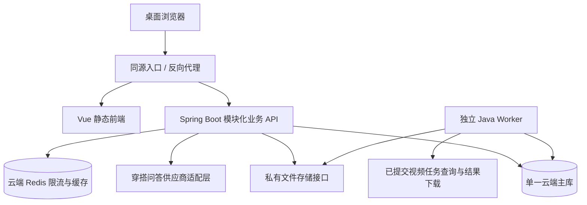

# 映想业务扩展与工程架构选型

日期：2026-10-27。状态：用户已确认重构后前端采用 Vue＋Vite；后端按 Java／Spring Boot 路线细化。本文为目标架构与实施计划，应用迁移及新增业务尚未实施。

后续执行入口：[16-前后端技术与架构迁移执行方案](16-前后端技术与架构迁移执行方案.md)。本文保留选型与业务范围，详细工作包、兼容协议、数据导入、Worker／Redis、切换及回退统一按16执行；实际进度统一记录在05。16以PostgreSQL为技术设计基准，实例条件仍须核查，变更主库需同步方案与回归。

2026-10-27重设计：16升级为2.0，以六阶段方法组织M00—M25行为切片。本文F01—F06与此前P／B等编号保留为能力清单，不再作为独立执行队列；映射见16第4.2节，实际切片状态仅在05维护。正式项目位置／Git仓库不变，按迁移分支及必要的临时worktree隔离实施。

本轮业务范围由用户确定为：数字衣橱、搭配方案、穿搭计划，以及调用 AI 回答基本问题的场景穿搭助手。项目继续定位为实时画面创作，本轮围绕换装补充关联业务。

本文描述建议目标，不覆盖当前运行事实。现有架构与迁移结果见 [README](../README.md)、[后端手册](../backend/README.md)及[原迁移计划](13-FastAPI后端与SQLite完整迁移计划.md)。新增 FR、页面状态与验收编号在范围细化后统一写入设计主文档，本文不另建第二套正式需求编号。

## 1. 结论与适用条件

重构目标采用：**Vue 3 / Vite / TypeScript + Java / Spring Boot 模块化单体 + 一个云端关系型主库 + 云端 Redis + 独立 Java Worker。** 前端用 Vue Router 管理页面，Pinia 管理共享界面状态，TanStack Vue Query 管理服务端数据；私有文件存储与同源反向代理承接媒体和 API。首阶段按 Docker Compose 组织可复现运行环境。

本决策替代本文早先“保留 Next.js／FastAPI、引入 Celery”的目标建议；现有 Next.js／FastAPI／SQLite 仍是实际运行工程。用户已说明拥有云端 MySQL、PostgreSQL 和 Redis；主库建议优先核查 PostgreSQL，最终根据版本、规格、地域、备份与网络条件确定，不同时引入两套关系型业务主库。云实例尚未连接或写入。

前提是继续围绕现有工程扩展，暂未给出需要多地域、高可用集群或独立业务团队部署的条件。采用模块化单体，同一业务后端代码库中明确模块、事务与依赖边界；API 和 Worker 可以独立运行与扩容。是否进一步拆分服务，以实测瓶颈和团队边界为依据。

企业工程的交付标准包括：模块责任清楚、权限逐请求验证、数据和任务可恢复、接口有合同、费用可追踪、部署可复现、迁移有核对、失败有定位。新增中间件会增加部署与维护成本，按阶段引入并验收。

## 2. 现状核查

| 核查位置 | 当前事实 | 对扩展的影响 |
| --- | --- | --- |
| frontend/package.json | Next.js 16.4.2、React 19.3.1、TypeScript 5.9.3；样式以现有 CSS 为基础 | 组件及 React hooks 迁为 Vue SFC／composables；纯 TypeScript 媒体与业务逻辑先核对再复用 |
| backend/requirements.in | FastAPI 0.161.1、SQLAlchemy 2.1.6、Alembic 1.20.1；Python 3.13 | 业务服务、鉴权、事务和迁移转为 Java 对应实现；保留旧合同和数据核对证据 |
| backend/app/db.py | SQLite 文件路径、PRAGMA、BEGIN IMMEDIATE、单机 readiness | PostgreSQL 迁移需要重构方言、连接池、事务与运维检查，不能只改连接字符串 |
| backend/app/main.py | 多数路由集中注册；lifespan 启动作品保存循环；upload_busy 是进程状态 | 路由应按业务模块整理；多 API 进程前需处理任务重复执行和全局上传限额 |
| backend/app/works.py | 用户私有本机目录；asyncio.Lock 存放于进程内 | 多进程需用数据库任务认领与并发控制；媒体访问需要存储抽象 |
| frontend/src/components/site/works-page.tsx | 列表、筛选及修改由页面自行请求与刷新 | 多模块关联后适合统一服务端数据缓存与失效规则 |
| frontend/src/lib/server/backend-proxy.ts | 仅支持回环 HTTP 后端；白名单头；统一 130 秒上限 | 容器网络和助手流式响应需要专门适配，不能直接复用配置宣称可部署 |

上述为源码和配置核查，不是容量测试结论。已有供应商调用、权益流水、沙盒支付和作品保存语义应在迁移中保留。

## 3. 技术选型与引入阶段

| 层次 | 建议选择 | 目的与引入条件 |
| --- | --- | --- |
| 前端框架 | Vue 3＋Vite＋TypeScript；Composition API 与 script setup | 正式工程继续统一在 frontend/；页面改为 Vue SFC，开发和构建由 Vite 负责 |
| 前端路由 | Vue Router，HTML5 history 模式 | 保留现有网址、嵌套路由、登录返回位置和404；静态服务器支持深链接刷新 |
| 前端状态 | Pinia＋TanStack Vue Query | Pinia 管理主题、语言和共享界面状态；Vue Query 管理列表、分页、详情和关联失效，不重复维护两份服务器数据 |
| 组件与样式 | 延续现有 CSS／CSS Modules 和设计变量，按 Vue 适配 | 保留雾白、暖灰、莓果红及现有桌面视觉；不因迁移默认重做设计或增加组件库 |
| 后端框架 | Java＋Spring Boot＋Spring MVC | 模块化 Controller／Service／Repository、请求校验、统一错误与 OpenAPI 合同；正式后端仍维护在 backend/ |
| 身份与运维配套 | Spring Security、受保护的 Actuator／Micrometer | 资源归属、会话兼容、健康检查、指标；不直接套默认登录页或默认会话格式覆盖旧合同 |
| 数据库 | 云端 PostgreSQL 优先评估；Spring Data JPA＋Flyway | 用户已有云端 MySQL／PostgreSQL；以单一主库保存正式账本和业务关联，主库切换单独演练 |
| Redis | 用户已有云实例，Spring Data Redis 接入 | 共享限流与短期缓存，按需求承接共享会话；接入前核查实例模式、TLS、权限、容量和淘汰策略 |
| 后台任务 | 独立 Java Worker＋数据库持久化任务表 | 处理已有视频结果轮询、下载、合并、缩略图；任务认领、租约和有限重试先落地 |
| 任务可靠性 | 主库保存任务与认领状态 | 初期可按库认领执行；后续引入队列仍保留数据库补偿与幂等，不默认新增 RabbitMQ 或沿用 Celery |
| 文件存储 | 存储接口先落地；目标为私有对象存储 | 单机阶段可保留受控本地实现；多机器前接入经验证的对象存储服务 |
| AI 助手 | Java 供应商适配层＋SSE；按供应商评估 Spring AI | 基础问答与衣橱上下文；模型、SDK、框架兼容、数据接收方与预算另行验证并固定 |
| 身份权限 | 延续服务端 Cookie 会话，完善统一鉴权依赖 | user/admin 与资源所有者校验；API 和 Worker 都按用户归属处理数据 |
| 部署 | 静态前端＋同源代理＋Spring Boot API／Worker；Docker Compose | Vite 构建产物由静态服务器部署；使用已有云主库与 Redis，按需启动隔离测试依赖 |
| 质量与运维 | vue-tsc、Vitest／Vue Test Utils、JUnit、Testcontainers、桌面 E2E 与 CI | 迁移框架相关测试；保留可复用纯逻辑用例，新增真实目标数据库与媒体清理回归 |

Vue＋Vite 为用户已确认方向，其他配套按实施验证细化。Java 21 为建议起点，Spring Boot 与 Spring AI、数据库驱动等需做兼容验证。实际使用的 Java／Node 运行时、依赖补丁版本和镜像摘要在建工程时锁定；本文不把尚未安装的版本写成已验证。

### 3.1 候选比较

- Vue＋Vite：按用户选择实施，接受组件、路由、构建与界面测试的移植工作；保留可复用的纯 TypeScript、CSS、图片和媒体算法。
- Java／Spring Boot：按前述讨论的路线细化；当前账号、订单、模型接入及媒体保存需要兼容迁移。原 Python 后端在切换前继续作为合同和数据核对依据。
- PostgreSQL／MySQL：均可承载本轮业务。优先核查现有 PostgreSQL 云实例；若 MySQL 在可用版本、网络、备份或规格方面更合适，再记录选型变更并统一 SQL 方言与测试。
- Redis／任务进程：按 Java 配套实现；任务状态与费用账本保存在主库。基本问答直接通过 API 流式返回，单次回答不默认绕行任务队列。
- 数据查询：分类、名称与日期先使用数据库索引和分页；当前基本问答从结构化衣橱中取上下文，暂不需要向量数据库或完整 Agent 编排。

### 3.2 Vue＋Vite 前端迁移工作包

| 工作包 | 实施内容 | 验收要点 |
| --- | --- | --- |
| F01 工程与路由 | 在 frontend/ 维护 Vue、Vite、TypeScript、Vue Router、构建与锁文件；按现有页面清单迁移 | 深链接、刷新、前进后退、404、路由懒加载；npm 命令仍在 frontend/ 执行 |
| F02 界面与偏好 | React 组件转 Vue SFC；公共布局、通知、弹窗、主题和中英文适配 | 既有桌面视觉、交互、键盘可用性保持；无新主题闪烁或未翻译文案 |
| F03 API与身份 | 统一 API 客户端、OpenAPI 类型、Pinia 与 Vue Query；处理401、退出、账号切换和迟到响应 | 原错误码／Cookie／来源／归属语义；清除旧账号私有缓存，敏感写请求不自动重试 |
| F04 创作与媒体 | hooks 改为 composables；复用并验证相机、SDK、会话控制、录制上传、镜像、截图和导出 | 取消／路由离开／后台／账号变化清理；计时规则、同连接换衣、默认保存与镜像像素回归 |
| F05 页面与作品 | 迁移首页、价格、帮助、反馈、协议、账户、管理、三种创作与作品等现有页面 | 旧网址可达，作品检索／收藏／回放／Range／下载／删除合同一致 |
| F06 构建与部署 | 开发 Vite 代理；生产静态资源和同源 API 代理；替代 Next 的页面元信息与服务端偏好读取 | 构建产物、缓存、深链接、未知API/资源404、上传限制、SSE刷新输出；无私有密钥进入前端 |

Vite 的构建不等同 TypeScript 类型检查，交付流程必须包含 vue-tsc。开发 server.proxy 不会随静态构建产物部署，生产必须显式配置 /api 转发、Range 与 SSE；HTML fallback 仅用于页面路由，不能把 API 错误或缺失资源改成200页面。vite preview 仅用于本地预览。

原 Next 的 cookies、Metadata、服务端模块和请求转发不能直接搬入浏览器代码。语言与主题优先读取允许客户端访问的偏好配置，登录态经本人接口核验；前端不读取 HttpOnly 会话。VITE_ 变量会进入客户端，只允许非敏感公开配置。页面标题、描述和公开页是否需要预渲染单独验收，不能把客户端 meta 更新当作等价的服务端 SEO。

只做桌面迁移与验收；新增衣橱、方案、计划和助手页面在原能力迁移稳定后按需求开发。前端与后端分步切换，避免同时改变组件框架、身份协议和数据库后难以定位问题。

## 4. 目标结构与模块边界

图中为新增业务与后台任务关系。现有实时媒体连接与临时令牌路径需要单独保留、回归，不改成通过聊天接口传输实时视频。

建议业务模块：

| 模块 | 负责的数据和行为 |
| --- | --- |
| identity | 用户、会话、角色、资源归属与账号停用 |
| wardrobe | 衣服、分类、颜色、季节与服装图片关联 |
| outfits | 搭配方案、单品关联、备注及试穿作品关联 |
| planning | 日程、出行计划、方案排期与行李清单 |
| assistant | 会话、消息状态、上下文选择、搭配建议与调用记录 |
| creation | 实时换装、视频换装、实时编辑及供应商适配 |
| assets / works | 媒体资产、作品索引、访问鉴权、保存与清理任务 |
| billing / admin | 原权益、预算、沙盒订单、运营开关与审计 |

Java 每个业务模块按需要包含 Controller、DTO、Service、Repository；Controller 处理 HTTP，Service 执行业务与事务，Repository 负责数据访问。Vue 侧按业务划分 views、components、composables、api 和 types，共享 router、stores 与基础组件。跨模块通过明确的服务接口协作，共用事务时由调用方编排，不在任意 Controller 中直接修改其他模块的表。

数据关联建议：用户拥有衣服；方案通过关联表引用多件衣服；计划引用方案；方案关联零至多件作品。行李清单从计划引用的方案汇总，并按服装 ID 去重。衣橱删除、方案变更对历史计划和作品的影响，需要在需求细化时明确快照或归档规则。

## 5. 必须随架构一起完成的工程规则

### 5.1 事务与后台任务

- 任务、预算预留、业务请求 ID 存数据库；用唯一约束、原子条件更新或行锁控制竞争。
- 长期数据库事务中不进行 AI、支付或媒体下载等网络调用。
- 业务提交与任务通知间存在失败窗口：采用同事务待派发记录（outbox）或数据库定期补偿扫描，确保任务最终可重新派发。
- Worker 按任务 ID 认领，设置租约、心跳或超时回收；重复投递不会重复生成或重复记账。
- 对已提交任务的状态查询、文件下载可有限重试；可能收费的创建请求如结果未知，应保留 unknown 及风险占用，先核查，不盲目重发。
- Redis 故障时要明确降级；任务与费用记录仍以最终选定的关系型主库为准。采用 Redis 做全局限流时，故障不能静默放开付费接口。
- 进程内锁不能作为跨进程互斥依据；实时分片还需设计会话到上传节点的归属，或实现可共享的分片暂存，之后才允许 API 多副本。

### 5.2 AI 助手

- 首版覆盖基础穿搭问答与用户主动选择的衣橱上下文；先使用名称、分类、颜色等已确认信息，图片识别另行验证。
- 服务端验证所选服装属于当前用户，限制上下文数量和对话长度；模型推荐的服装 ID 需再次校验，缺少的单品明确作为建议展示。
- 回答可以返回可保存的方案建议；保存方案、安排日程和开始换装均由用户主动确认。
- SSE 需覆盖断开、取消、超时、部分回答、最终完成与失败；中断不能标为完整成功，也不能自动重新收费生成。
- 记录调用 ID、模型/模板版本、供应商返回的实际用量及结果状态；未返回的费用不能补造为实测。预算预留与最终用量分开。
- 对话历史与衣橱属于新的留存范围，实施前明确保留期限、删除方式和云端告知；日志不保存消息正文、图片、令牌或完整供应商响应。
- 初次真实调用前确定供应商、密钥、预算和停止条件。现有实时编辑账号不限次授权不自动扩大到新助手。

### 5.3 前端状态与合同

- 统一 API 客户端处理错误码、请求 ID、取消与鉴权状态；继续由 OpenAPI 生成类型并检查漂移。
- 查询缓存键包含用户身份；退出、切换账号时取消旧请求并清除私人缓存，避免迟到结果写入新账号界面。
- 衣橱修改需刷新相关列表和详情；方案/日历有明确关联失效规则。价格、权益、预算、AI 创建请求不使用普通读查询的自动重试策略。
- 相机、媒体轨道、MediaRecorder 与 SDK 对象继续由独立生命周期管理，不放入可持久化的查询缓存。
- SSE、视频 Range、上传进度与普通 JSON 请求分别定义超时和代理规则。容器后端地址采用显式受信配置，同源、来源验证和头白名单继续回归。

### 5.4 存储、部署与可观测性

- 媒体保存对象键、类型、大小、校验值、所有者和状态；业务数据库不保存视频二进制。
- 私有访问可采用后端鉴权转发；评估临时签名链接时，应处理有效期内持有链接者可访问、缓存及删除时效的变化，再更新隐私与合同。
- 对象存储迁移先复制、核对字节和抽样播放，再切读写；明确删除、孤立文件清理和分片收尾规则。
- 开发/测试/生产配置隔离；首次迁移通过独立运维步骤执行，多 API 实例不各自启动迁移或周期调度器。
- 记录请求 ID / 任务 ID 贯穿的脱敏日志；监测 API 延迟、错误率、队列积压、任务超时和 AI 用量，阈值在内测容量目标明确后设置。
- 先交付基础日志、健康检查、指标与告警入口，再根据运维环境接入监控平台。
- 数据库和媒体分别制定备份与恢复流程，并演练两者一致性；只备份数据库不等于作品可恢复。单机 Compose 部署也不代表高可用。

### 5.5 Windows 开发环境

当前本机是 Windows。Java API／Worker 可按所选 JDK 与构建工具在本机验证；需要 Linux 容器时再核查 Docker、WSL2、虚拟化、端口、磁盘和权限。目标 Java 方案不再依赖 Celery，之前的 Celery Windows 限制仅属于原候选方案。

用户已有云端 MySQL、PostgreSQL、Redis；本机接入前核查访问白名单、TLS、网络延迟、连接数与开发测试隔离。云资源存在不代表实例已满足性能、备份或恢复目标。对象存储服务仍未选择，本地存储适配可支持不依赖该决策的开发。

## 6. 分阶段实施与验收

已有需求关联：FR09/10/11 的限流、数据告知及运营控制；FR24/31 的实时编辑；FR46 的私有作品保存；FR47—49 的工具与整理；NFR06—09 的资源、性能、容量与可操作性。新衣橱、搭配、计划和助手需求需回写唯一主基线并分配验收编号，不能沿用旧编号冒充已验收。

| 阶段 | 工作包 | 完成条件 |
| --- | --- | --- |
| A 范围与目标 | 16的W0／M00—M02：冻结合同／合成样本、环境和恢复入口；新增业务另行细化 | 主基线／T51一致，G0按实际所需条件满足，未知项不扩散阻塞 |
| B 前端迁移 | W1—W2／M03—M09：按公开浏览、账号、本机媒体、作品和创作逐片完成，最后只切前端 | 各片有新鲜证据；G1通过，后端与正式数据保持原来源 |
| C 后端与数据 | W3—W5／M10—M23：首条Java读取、身份／账本／任务／作品／Worker／Redis行为，最终导入／切流 | G2／G3／G4依次通过，逐用户／unknown／完整作品与提示词核对，恢复有证据 |
| D 存储与交接 | W6／M24—M25：对象存储迁移及旧实现退役，运行资料可接续 | 存储／Range／删除／联合恢复通过；M24未完成时保持同机私有卷边界 |
| E 新业务与AI | 当前功能迁移稳定后依次完成衣橱、方案、计划；助手替身可在需求冻结后交错开发，真实调用另有预算 | 新FR／页面状态／验收编号统一回写主基线；效果／SSE／用量及发布回归有实际证据 |

切换现有数据库前停写并备份 SQLite 和媒体，导入新库后核对主键、密码摘要、会话、订单、授权、使用、未知占用与作品索引；不因重构重新送额度。旧数据库保留作只读核对，不双写。新库接受写入后，不能直接切回旧快照丢弃新增业务数据，应维护停写并做受控修复或核对后的恢复。

测试策略：迁移期间保留现有 Python／前端验证作对照；Vue 用 vue-tsc、Vitest／Vue Test Utils，Java 用 JUnit／Testcontainers，接真实目标数据库完成迁移与事务集成、Worker重复执行和崩溃恢复、对象存储访问与删除、助手替身流式测试，以及桌面跨模块 E2E。纯 TypeScript 测试核对后复用，不按旧测试数量宣称新框架通过。合同漂移、类型检查、构建和核心测试组成持续集成门槛；远程 CI 平台在仓库托管确定后配置。本轮不扩展手机适配与测试。

容量目标待内测条件确定；当前没有新架构压测、生产部署、AI 助手效果或费用实测结果。

## 7. 本轮交付与待决策项

本轮完成技术方向记录、Vue／Vite／Router官方文档核对和迁移工作包设计。现有前后端源码、依赖与运行服务尚未切换；未连接云数据库、迁移数据、调用模型、购买服务、发布或创建 Git 提交。

实施前需明确：目标运行环境和资源；内测规模与并发；新增媒体/对话留存规则；AI供应商、模型与预算；对象存储服务；备份恢复目标。上述依赖不阻止先做领域设计、接口、原型和替身验证。

## 8. 官方资料

以下文档于2026-10-27查阅；组件适用性是结合本项目源码作出的工程判断，资料本身不构成本项目性能验证。

- [Vue 快速开始](https://vuejs.org/guide/quick-start.html)、[TypeScript 工具链](https://vuejs.org/guide/typescript/overview.html)：Vite、SFC及vue-tsc类型检查。
- [Vite 静态部署](https://vite.dev/guide/static-deploy.html)、[环境变量](https://vite.dev/guide/env-and-mode.html)：构建产物、预览服务和客户端配置边界。
- [Vue Router history模式](https://router.vuejs.org/guide/essentials/history-mode.html)：深链接与服务器fallback。
- [Pinia](https://pinia.vuejs.org/introduction.html)、[TanStack Vue Query](https://tanstack.com/query/latest/docs/framework/vue/overview)：界面共享状态与服务端数据管理。
- [Spring Boot](https://docs.spring.io/spring-boot/reference/index.html)、[Spring AI兼容说明](https://docs.spring.io/spring-ai/reference/getting-started.html)：Java配套与版本验证依据。
- [PostgreSQL 并发控制](https://www.postgresql.org/docs/current/mvcc-intro.html)、[显式锁](https://www.postgresql.org/docs/current/explicit-locking.html)：事务与行级竞争设计依据。
- [S3 临时签名访问](https://docs.aws.amazon.com/AmazonS3/latest/userguide/ShareObjectPreSignedURL.html)：一种候选私有媒体访问机制，不表示已选择 AWS。
- [Docker Compose 生产环境](https://docs.docker.com/compose/how-tos/production/)：环境配置与单服务器部署依据。
