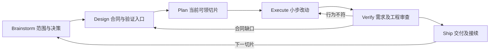
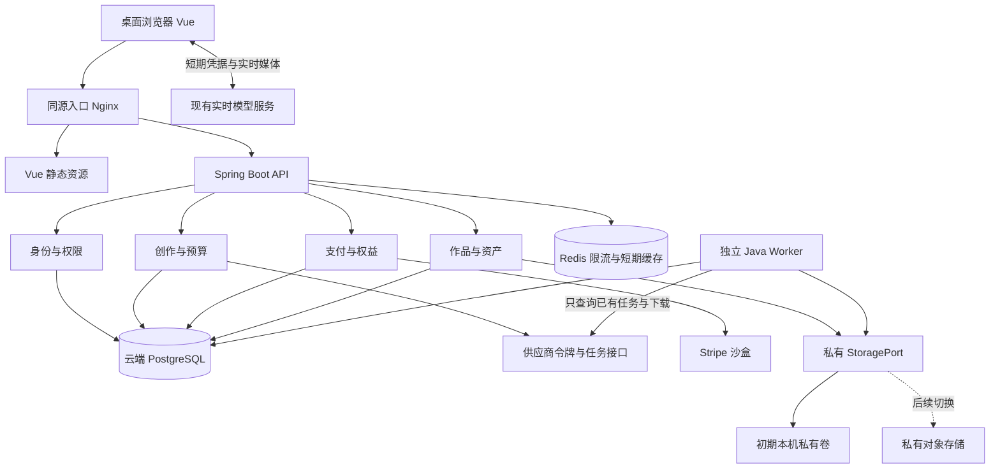

# 映想前后端技术与架构迁移执行方案

版本：2.0。日期：2026-10-27。状态：迁移实施已启动，实际进度统一见05；当前应用仍为Next.js／FastAPI／SQLite，尚未切换新技术栈。

阅读顺序：[执行结论](#1-执行结论与重设计原因) → [需求澄清](#2-brainstorm需求与决策账本) → [方案设计](#3-design迁移合同与验证入口) → [切片计划](#4-plan按可验证行为拆分迁移) → [执行纪律](#5-execute每次只推进一个可验收切片) → [验证审查](#6-verify需求与工程约定分别审查) → [交付接续](#7-ship版本切换恢复与接续) → [技能配置](#8-技能与工具接入)；具体前后端、数据库、媒体与部署规则见附录A—H。

## 1. 执行结论与重设计原因

### 1.1 项目迁移方式

正式项目继续维护在 `C:/Users/sun/Desktop/anyware`，使用现有同一个Git仓库和 `codex/architecture-migration` 迁移分支（2026-10-27已创建，尚未提交迁移改动）。Vue工程仍在 `frontend/`，Java工程仍在 `backend/`。当前目录可作为开发位置；旧服务需要持续运行时，先用同仓库的临时worktree隔离施工。worktree不是第二套长期项目，数据库、私有文件和secret也不会随Git自动复制。

目标技术方向保持：Vue 3／Vite／TypeScript＋Spring Boot模块化单体＋单一云关系主库＋已有Redis＋独立Java Worker＋私有存储接口。PostgreSQL是设计基准，实例条件与具体版本仍须核查；MySQL仅作为条件不满足时的重新评估项。既有费用授权、账号例外、账本与作品数据规则保持。

### 1.2 从参考网页采纳什么

[参考网页](https://czm15053.github.io/ai-workflow-six-stages/)将AI协作分为Brainstorm、Design、Plan、Execute、Verify、Ship，并强调书面产物、行为切片、验证与接续。本文借用其阶段框架；以下批次、合同、门槛和取舍均按映想现有代码与数据风险重新设计，不套用网页中的业务案例或安装所有框架。

| 对1.0的项目复核 | 2.0的具体调整 |
| --- | --- |
| F／B按框架和技术层列出，容易出现多个模块都说完成、页面仍走不通 | 原22个工作包保留为能力覆盖索引；实际领任务改为M00—M25可验证切片 |
| 阶段门槛只说明技术是否齐备，缺少当次操作依据 | 每片绑定主需求／页面状态、验证入口、比较点、允许环境、完成证据与恢复方式 |
| G1／G2整批验收之前反馈较晚 | 每片先有可复现观察点、当片反馈和两类审查；批次门槛保留作最终集成约束 |
| 未明确哪些已确认、哪些是技术建议、哪些取决于云资源 | 建立决策账本；依赖只阻塞相应动作，不阻塞本地合同和替身工作 |
| 原方案没有把上一轮关于“原位置／另起目录”的讨论写为执行规则 | 固定同仓库＋迁移分支，worktree按运行隔离需要使用；Git与数据恢复分开 |
| 后续会话容易重读全部资料或把方案完成误当工程完成 | 05记录状态，任务卡记录当前范围，报告保存证据；临时交接引用这些文件 |

### 1.3 两个维度与五个技术门槛

“六阶段”描述每次工作怎样闭环；“迁移批次”描述系统怎样逐步替换。每个M切片都执行六阶段中的必要动作，不能理解为先把全项目需求／设计／计划分别做完，再一次写完所有代码。小文案或文档修正可合并检查；身份、账务、媒体、数据和切换必须保留完整证据。



| 技术门槛 | 本项目中意味着什么 | 由谁提供证据 |
| --- | --- | --- |
| G0 基线可复现 | 原行为、合成样本、隔离环境与当片验证入口已就绪 | M00—M02及任务卡 |
| G1 Vue兼容完成 | Vue接旧FastAPI，全部原页面／桌面媒体／入口合同通过；允许只切前端 | M03—M09 |
| G2 Java集成完成 | Vue接隔离Java／PG／Redis，原能力、Worker与故障合同通过 | M10—M20及批次回归 |
| G3 数据切换准入 | 最终源／目标零未解释差异，联合备份可恢复，停写和外部调用门禁已验证 | M21、切换检查表；满足后执行M22 |
| G4 现有能力迁移完成 | 切换后的新栈、任务收尾、故障恢复及运行交接均有证据 | M22／M23；对象存储单独由M24验收 |

门槛是事实判断，不是每一步重复请求许可。已有用户决策不重问；可以自主完成的可逆设计、开发、替身验证和修复持续推进。Git提交仍须用户明确审核同意，真实AI／支付测试按具体预算与停止条件，购买／公开发布不因计划获批而自动授权。

### 1.4 唯一事实来源

| 内容 | 唯一维护位置 |
| --- | --- |
| 产品规则、FR/NFR与T51 | [主文档](../实时虚拟试衣网页项目设计文档.md)；本方案引用编号，不另建PRD版本 |
| 迁移设计、依赖与门槛 | 本文；[15](15-业务扩展与工程架构选型.md)保留选型背景 |
| M切片实际状态／阻塞／报告入口 | [05-开发任务与验收](05-开发任务与验收.md)；任务卡不重复维护独立状态 |
| 当前切片执行上下文 | `docs/migration/tasks/<M编号>-<主题>.md`，开工时创建；本轮只落地首张M00卡 |
| 实际执行及审查证据 | `docs/reports/`中的切片报告；敏感原始输出留受保护目录，报告只留脱敏摘要 |
| 接口与技术增量 | [07](07-接口契约与工程实现.md)、`docs/api/`、[04](04-技术设计补充.md)中的决策 |
| 跨会话临时接续 | Windows `%TEMP%`下的handoff；引用上述材料，不作为另一个长期状态库 |

原13及按日期报告是历史证据，不能被2.0改写成新的实测结果。1.0工作包尚未实施，其待办状态由本轮迁移到M切片，不重复计数。

## 2. Brainstorm：需求与决策账本

### 2.1 当前问题与范围

迁移的直接目标是：在保留现有页面、账号、权限、账务、三场景创作及私有作品行为的条件下，形成能长期维护的Vue／Java工程与可恢复的数据／任务基础。验收观察的是原行为是否保持、异常是否受控、数据是否可核对，不以新建了多少类或安装了多少中间件衡量进度。

本轮先完整迁移当前功能：首页、价格、帮助／反馈／协议／隐私、账号与权益／订单、管理员、实时换装、视频换装、实时编辑、我的作品、中英文及明暗偏好。只调整和验收桌面端，保留当前雾白、暖灰与莓果红视觉和已确认文案。

数字衣橱、搭配方案、穿搭计划、基础问答助手属于下一批功能。迁移时预留模块边界；在主文档补齐正式需求、页面状态、删除／留存与验收编号以后，才进入功能实施。当前临时最多6张服装参考图的衣橱，不视为已实现持久化数字衣橱。

| 需求关联 | 迁移不变量 | 页面状态与验收关联 |
| --- | --- | --- |
| FR01—11、FR13/14/18、NFR06—09 | 访客可准备素材及本机相机；开始前登录与云端确认；无自动生成、自动重连或音频采集 | 未登录／素材无效／相机拒绝／连接中／运行／结束／失败；沿用原T01—T15、T17/18及T51 |
| FR15/16/21/35 | 固定商品与金额快照；沙盒支付及积分和真实模型权益隔离；正式支付关闭 | 购买确认／取消／创建未知／待付款／已付款／查单失败；T16/21/36及T51 |
| FR21/23/24/31 | 实时首帧实际播放后计时；连接等待独立30秒；同连接换衣或改提示词不续时、不另签令牌 | 连接等待／播放／组合更新／全部移除／超时；T21/23/24/32及T51 |
| FR10/23/27/29/30/31/46 | 默认保存无声生成视频及已用参考图；原相机和输入人物视频不持久化；私有作品与已同步提示词历史保留 | 上传／保存中／部分保存／保存失败／ready／删除；T23/28/30/31/32/47及T51 |
| FR39/40/43—45 | 中英和主题偏好；user/admin及停用；即时鉴权、管理幂等与审计 | 匿名／无权／加载／失败／版本冲突／确认；T40/41/44—46及T51 |
| FR47—49 | 全屏不影响生成；截图仅主动本机导出；镜像下载写入像素；作品搜索、排序、收藏与账号隔离 | 未就绪／导出中／取消／失败／零结果／收藏；T48—50、T30/47及T51 |

以主文档后续修订覆盖早期阶段的旧规则，例如FR46覆盖此前“不默认录制”，实时编辑的首帧计时覆盖早期“包含连接准备”。历史报告原样保留，迁移测试必须采用当前生效行为。

现有 `suny` 实时编辑不限次数／累计预算／冷却的例外保持；它不扩大到其他账号、视频或新助手。视频原US$5／20次累计门禁、已有 issued／unknown 与风险预留完整保留。本文不触发真实调用，不自行增加测试预算。

### 2.2 决策账本

下列状态描述依据强度，不表示技术已实现。“技术建议”可以先在隔离环境验证，不能被写成用户已逐项审批。

| 决策 | 状态／依据 | 开工和停止边界 |
| --- | --- | --- |
| Vue／Vite前端；当前项目与Git版本管理 | 用户已明确；现有会话及15 | 不重新选前端框架，不复制为独立长期仓库 |
| Java／Spring Boot、模块化单体与独立Worker | 既有迁移路线，用户要求据此细化 | 可做底座和兼容实现；更改服务拆分方式须先记录决策 |
| Java 21、Maven、JPA／Flyway、Nginx | 2.0沿用的技术建议，尚未安装验证 | 先做小型兼容验证和锁版；失败回到Design，不能静默换库／框架 |
| PostgreSQL优先、仅一个主库；使用已有Redis | 用户已有资源，实例条件待核查 | 可先用隔离PG／Redis；正式云资源未确认则不能最终导入／切换 |
| 同机私有卷先行，对象存储后续 | 当前媒体路径及存储待选状态 | 同机可开发验收；多机前须完成共享存储及并发验证 |
| 内测容量、RPO／RTO与可接受停机窗口 | 待运行条件明确 | 可测基线；未确认目标不宣称达标，切换卡必须给出实际窗口与中止点 |
| 新助手供应商、预算、对话留存 | 不属于本次旧能力迁移 | 可做下一批需求／替身设计；不可沿用suny实时编辑例外调用新模型 |

事实优先查README、源码、合同和既有报告；只在缺少影响当前切片的业务取舍时提问。未知云配置列入阻塞，不能为了推进计划猜一个实例地址或把本地替身当作云端验证。

### 2.3 外部条件

| 条件 | 需得到的证据 | 缺失时可继续／不能执行的步骤 |
| --- | --- | --- |
| PostgreSQL实例条件 | 非敏感版本／规格／网络／TLS／备份说明，隔离测试库和最小权限凭据 | 可做设计、容器或本地测试；不能写正式云库、最终导入或宣称云端通过 |
| MySQL优于PostgreSQL的实际条件 | 两实例可用性比较及选型变更记录 | 若改用MySQL，先重写方言／排序／锁／迁移测试；不得在同一版本维护两个业务主库 |
| Redis可用条件 | 独立测试命名空间或实例、ACL、可执行原子脚本、TLS与故障行为 | 可替身开发；不能宣称共享限流或多实例通过 |
| Windows／容器环境 | JDK／Node版本、Docker／WSL2可用性、端口／磁盘 | 无容器时先原生运行；真实数据库集成测试仍必须执行，不能以H2替代 |
| 私有对象存储 | 服务、地域、权限、大小／Range／删除／校验支持及费用 | 可先实现本机私有适配；不能多机部署或宣称对象存储迁移完成 |
| 容量／恢复目标 | 内测人数、同时生成／上传量、可用内存、RPO／RTO | 先测基线并报告结果；目标未确认不作容量或恢复达标结论 |
| 真实AI／支付验证 | 场景、账号、次数／金额、停止条件及可用密钥 | 继续替身测试；不自动探测真实签发、创建订单或发送模型请求 |

凭据通过服务端配置或受控secret提供，不写入执行文档、聊天日志或Git。用户已有云资源不等于已授权购买、充值、公开开放网络或生产写入。

## 3. Design：迁移合同与验证入口

### 3.1 目标结构和迁移状态



实时媒体继续由浏览器使用短期令牌直连现有供应商；后端签发和业务账本不转到前端。API和Worker共享同一数据库与存储协议，独立进程运行。新助手未来走独立供应商适配与SSE，不复用实时媒体通道。

| 状态 | 用户入口／前端 | 业务API | 数据与后台 | 用途 |
| --- | --- | --- | --- | --- |
| S0 当前 | 8787 Next.js | 8788 FastAPI | SQLite＋现有保存循环 | 持续可运行的原基线 |
| S1 隔离验收 | Vue在隔离端口 | 隔离FastAPI／合成供应商 | 临时SQLite及合成媒体 | Vue与旧合同验证，不碰正式权益 |
| S2 前端切换后 | 8787 Vue静态入口 | 8788 FastAPI | 原SQLite和私有目录 | 前端迁移完成；后端与数据尚未切换 |
| S3 Java演练 | 隔离Vue入口 | Java隔离端口 | 隔离PG／Redis、复制媒体、Java Worker | 全合同和导入／故障演练 |
| S4 后端切换后 | 8787 Vue静态入口 | Java API | 云主库／Redis、单Worker、私有卷 | 现有功能的新技术栈闭环 |
| S5 存储部署验收后 | 经验证的统一入口 | Java API | 已验收存储及恢复流程 | 为受控内测准备，不自动公开发布 |

S1／S3的实际端口由P01检查占用后记录。隔离环境默认关闭供应商网络出口、真实密钥及调度，支付只使用替身；不能将复制了正式订单的库连接可写Stripe或模型接口。只读影子比对也使用隔离快照，禁止将线上POST流量复制到新后端。

实际环境状态S0—S5与工作流六阶段独立。S1／S3允许按当前切片实现新框架／接口，未迁移能力使用明确的隔离fixture或保持不可用；只在集成门槛通过后改变实际运行入口。不把正式写请求分流到两套账本，也不把真实POST复制做影子测试。

### 3.2 责任归属和兼容合同

| 边界 | 唯一责任与观察点 | 应防止的错误 |
| --- | --- | --- |
| 浏览器／前端 | 本机媒体生命周期、交互与账号缓存隔离；观察DOM、轨道、上传和导出字节 | 前端隐藏代替权限校验；Vue卸载后迟到流仍运行 |
| 身份／授权 | 身份过滤装配Principal；授权策略服务集中判资源归属／管理角色，业务事务检查当前授权 | Controller、Repository各自猜owner；只信前端role或X-Work-Owner |
| 账本／外部调用 | 主库短事务预留／确认、唯一幂等键；供应商请求计数与公开账务结果可观察 | 网络未知自动返还、换request ID重复收费、Redis失效重置权益 |
| Worker／媒体发布 | 主库认领／代次、StoragePort受控发布／删除 | 租约过期旧进程覆盖文件、删后复活、合并长事务占库 |
| 同源入口 | 外部Origin／Cookie／原始body／Range／错误保持 | 容器Host改写、API返回HTML、multipart或通知重编码 |
| 导入／恢复 | 受控快照与运维工具做逐表／逐用户／逐文件核对 | 只看总行数、漏prompts.json、Git回退冒充账本恢复 |

代码与数据细节按附录执行。旧scrypt／Cookie、沙盒隔离、unknown占用、主键和时间／金额单位均为兼容合同。任何有意改变都必须说明触发场景、影响的FR／T、兼容方式与回归，不能包装成纯技术重构。

### 3.3 先确定从哪里验证

| 验证入口 | 用于哪些切片 | 可以证明／不能单独证明 |
| --- | --- | --- |
| 桌面浏览器经实际入口操作 | M03—M09、M10—M18的用户路径 | 路由／Cookie／清理／下载像素；不能只靠截图证明服务端归属和账务原子性 |
| 同源HTTP API＋固定合成数据 | 账号／权益／通知／作品／错误合同 | 响应与副作用；不能用绕过入口的Controller单测证明代理原字节 |
| 供应商适配边界的HTTP替身 | M07／M08／M12／M14—M16 | 请求次数、参数、超时和unknown；不证明真实模型效果／费用 |
| 两进程＋目标PG／Redis | M12／M13／M17—M20 | 真实锁、认领、限流故障；内存仓储／H2不足以替代 |
| StoragePort＋故障注入＋文件字节 | M06／M15—M18／M21／M24 | 哈希、Range、分片／删除一致性；只看文件存在不证明可播放或本人可访问 |
| 运维命令的退出码、差异和恢复清单 | M00／M02／M21／M22／M23 | 无损导入、异常阻止切换、联合恢复；不等于已获准公开上线 |

高风险测试先从独立合成预期、旧实现的生效合同或明确FR生成断言，不从新实现反抄。余额／并发／恢复验证可以观察数据库约束和文件状态，这是本项目的数据不变量，不机械套用“只能测界面”或“只能一个测试入口”。

### 3.4 不确定项先做最小验证

先验证Vite能构建既有Decart SDK、Vue能正确回收一次合成媒体、Java能验证旧scrypt合成向量、PG能保证最后一次权益只成功一个、Worker旧代次不能发布。每项都形成可重复结果，再扩大到完整业务。依赖／供应商协议按实施时官方文档固定版本；不把网页示例当作当前软件说明。

设计决策继续记在04，不新建一套竞争ADR编号。新增规则需包含背景、备选、选择、状态、影响及T51子项。既有重复或历史ADR通过标题／日期定位，不顺带改写旧历史。

## 4. Plan：按可验证行为拆分迁移

### 4.1 批次与切片原则

一个切片交付一段可以演示或核验的行为，穿过该行为需要的UI、HTTP、数据、媒体和验证；不要求每片都重写原本不变的层。迁Vue时允许旧FastAPI保持不变，迁Java时允许已验收Vue保持不变。工程底座／锁文件等纯技术前置可单列，但必须给出自己的可执行检查。

下表M00—M25是实际执行索引；05是状态来源，表中Cxx均指T51-Cxx。宏观切片如果不能在一轮有界上下文中完成，开工前拆成Mxx-a／Mxx-b，每个子片都有独立行为和证据；拆分及状态同样记在05，不能把“做一半”写成父片完成。

| 批次／切片 | 真正阻塞项 | 独立交付行为 | 需求／页面／验收 |
| --- | --- | --- | --- |
| W0／M00 当前基线可复现 | 无 | 当前目录、Git／运行资产、未提交差异与恢复产物可定位，不修改现有服务 | NFR06—09；当前全部页面；T51-C10/12 |
| W0／M01 旧合同可自动对照 | M00 | 合成账号／unknown／订单／作品驱动旧HTTP，正常与拒绝结果可重复取得 | FR09/10/13—16/46；匿名／拒绝／正常；C01/03/07 |
| W0／M02 环境与恢复校验可运行 | M00 | JDK／Node、隔离PG／Redis／卷、secret名称清单与联合备份检查可运行；云条件另记 | NFR06—08；维护／不可用；C09—12 |
| W1／M03 Vue公开浏览闭环 | M01；M02中Node条件 | 首页到价格／帮助／反馈／协议／隐私深链接、语言主题与404可用 | FR34—42、NFR09；空态／搜索／错误；C02/11 |
| W1／M04 Vue账号与管理员身份闭环 | M03 | 旧后端下登录、本人读取、退出／换账号隔离和无权管理状态走通 | FR13/14/18/39/40/43；匿名／401／403；C01—03 |
| W2／M05 本机创作与画面工具闭环 | M04 | 选图／视频、相机／合成流、原画预览、全屏／截图／镜像导出与离开清理可用 | FR01—03/27/29/47/48；未就绪／取消；C06/07 |
| W2／M06 Vue本人作品管理闭环 | M04／M05 | 合成作品搜索／收藏／详情／Range／参考图／提示词／下载／删除可演示 | FR46/49；空态／保存／失败／已删除；C03/07 |
| W2／M07 Vue实时换装闭环 | M05／M06 | 使用SDK替身完成主动开始、首帧计时、同连接换衣、结束与分片保存 | FR04—11/20/21/46；连接／播放／部分保存；C05—07 |
| W2／M08 Vue视频与实时编辑闭环 | M07 | 先拆M08-a视频提交／unknown／作品收取，M08-b提示词组合／首帧计时／历史保存 | FR23/24/31/46；处理中／失败／全部移除；C05—07 |
| W2／M09 Vue账户运营与入口切换 | M06—M08 | 沙盒购买确认／查单、管理写入／公告和全部旧路由集成；G1通过后只切前端 | FR15/16/35/43—45、NFR09；取消／版本冲突；C01/02/04/11 |
| W3／M10 Java首条本人读取闭环 | M01；M02中Java／PG条件 | 兼容schema／Cookie过滤／错误，Vue经入口读取PG合成账号，匿名仍受控 | FR09/13/14；匿名／登录／不可用；C01/03/11 |
| W3／M11 Java登录与一次赠送闭环 | M10 | 旧摘要向量登录、注册只送一次、注销／停用撤销、限流失败不回滚 | FR09/13/14；冲突／密码错／停用；C03/04 |
| W3／M12 权益签发与未知占用闭环 | M11 | 页面选择档位→PG预留→替身签发→状态；竞争最后一次及确认前崩溃安全 | FR11/21；不足／unknown／issued；C04/05 |
| W3／M13 沙盒订单与管理写入闭环 | M11 | 拆M13-a订单／通知／查单只发一次，M13-b角色／权益／公告／审计原子变更 | FR15/16/35/43—45；重复／乱序／冲突；C03/04 |
| W4／M14 已有视频任务闭环 | M12 | 视频内存校验／去音轨→预算预留→替身提交／查询；unknown不重POST | FR23/26；无效／未知／处理／完成；C05/11 |
| W4／M15 实时作品保存闭环 | M12 | 拆M15-a分片／参考图原子保存，M15-b详情／Range／搜索收藏／删除防复活 | FR46/49；capturing／ready／deleted；C07/10 |
| W4／M16 实时编辑与提示词留存闭环 | M12／M15 | 编辑门禁／suny例外、同连接组合、默认保存和本人提示词历史都可验证 | FR24/31/46；更新失败／全部移除／旧作品空态；C05—07 |
| W4／M17 Worker收取已有结果闭环 | M14／M15 | 页面离开后独立Worker认领已知视频、下载／保存／有限重试，重启恢复 | FR23/46、NFR06—08；waiting／saving／failed；C07/08 |
| W4／M18 Worker合并删除与租约闭环 | M16／M17 | 两Worker竞争／旧代次／删除竞态／片段超时部分保存，不重复生成 | FR11/46；失租／部分保存／deleted；C07/08/10 |
| W4／M19 Redis与上传门禁故障闭环 | M11／M12／M18；M02中Redis条件 | 旧限流窗口和共享槽位生效，断连／淘汰时不放开新调用，已提交收尾可继续 | FR09/11、NFR06—08；503／恢复；C08/09 |
| W4／M20 新后端全入口兼容 | M13／M18／M19 | Vue＋Java经实际代理覆盖全部合同／页面／媒体，确认无旧服务依赖；G2 | 原FR／NFR；全部旧状态；C01—12相关项 |
| W5／M21 全量导入与恢复演练闭环 | M20、导入工具子片 | 冻结副本→导入→逐行／余额／文件核对→恢复；重复导入不增减；形成G3证据 | T25/26/51；异常拒绝／维护；C10/12 |
| W5／M22 最终停写导入与切流 | M09／M21、G3及实际资源条件 | 排空、联合快照、最终导入、只读验证、记录新库写入边界再按原权限开放 | 当前全部FR；维护／恢复；C01/10—12 |
| W5／M23 新栈稳定性与运行交接 | M22 | 重启／后台收尾／故障／联合恢复实测，运行文档与剩余风险可接续；G4 | NFR06—09；故障／恢复；C08—12 |
| W6／M24 对象存储迁移闭环 | M23、私有存储条件 | 完整复制／哈希→鉴权Range／删除→停写增量→单写切换→联合恢复 | FR10/46、NFR06—08；失败／deleted；C07/10/11 |
| W6／M25 旧实现退役闭环 | M23；M24完成情况明确 | 无旧进程依赖后移除旧框架／脚本，文档和恢复产物齐全，不删历史证据 | NFR06—09；重启／正常；C12 |

M00／M01中的行为基线可用现有测试入口取得；不能先假设数据库导入工具、Java命令和Vue检查脚本已经存在。M21的导入工具可在M10之后用合成数据先开发为M21-a；真正全量／故障／恢复演练仍阻塞于M20，不必等全部后端完成才写工具。

### 4.2 旧22个工作包的覆盖映射

| 1.0能力索引（不再独立领任务） | 2.0执行切片 |
| --- | --- |
| P01／P02／P03 | M00／M01／M02 |
| F01／F02 | M03—M09中的工程、路由、偏好与共享界面 |
| F03 | M04，以及M06—M09中的账号／缓存／请求隔离 |
| F04 | M05／M07／M08 |
| F05 | M03／M04／M06／M08／M09 |
| F06 | M03的隔离静态入口、M09的完整入口／切换；SSE仅预留 |
| B01／B02 | M10／M11 |
| B03 | M12／M13 |
| B04 | M12／M14／M16 |
| B05 | M15／M16 |
| B06 | M17／M18 |
| B07 | M19；多实例与Worker组合在M20复验 |
| D01／D02 | M21-a及M21 |
| R01／R02 | M22／M23 |
| O01／O02 | M24／M25 |

没有映射到新功能开发的衣橱／方案／计划／助手不能混进上述迁移片。它们在G4以后另补主需求；本机单卷模式下可继续独立开发，M24未完成仍不能宣称多机可用。

### 4.3 任务状态与开工条件

05使用“待办、可领取、进行中、验证中、受依赖限制、已完成”记录M切片；“等待提交审核”作为独立备注，避免把Git是否提交与工程验证混淆。切片全部验收通过后可记已完成并注明“未提交”；只有构建通过不能记完成。

当所有真正的前置切片和当前片所需环境满足时才可领取。不要把尚未需要的云预算、对象存储或新助手条件挂在M03前阻塞本地Vue开发。同目录改动串行；不默认启用多Agent或多个实现循环。需使用独立审查技能时遵守其调用条件与本项目权限。

## 5. Execute：每次只推进一个可验收切片

### 5.1 当前切片的上下文包

开工只读AGENTS、README、00、05当前状态、本方案相关条款和当前任务卡，再按任务卡读取关联源码／合同／报告。页面和账本风险必须查生效FR，不把整仓库、原始日志或全部聊天重复塞入上下文。

每张任务卡包含：

```text
任务ID／父片：
交付行为与不变量：
FR／NFR、页面状态、T51子项：
Blocked by：真正前置ID与当前所需环境
比较点：已审核commit＋本轮开始时的未提交文件指纹
上下文：需读文件／章节＋读取理由
允许修改范围／跨模块接口：
验证入口、独立预期、反例与副作用计数：
实际可执行命令：命令、目录、成功判据；未有脚本时先创建验证入口
运行环境：临时库／合成媒体／替身；外部调用、secret与预算边界
停止条件／失败回退：
证据报告位置／05状态入口／下一步：
```

本轮首张卡为[M00：固定当前基线](migration/tasks/M00-固定当前基线.md)。它是后续实施入口，当前卡片完成只表示任务已写清，M00实际资产／测试／恢复工作仍未执行。

### 5.2 短反馈循环

1. 固定当前差异和验证入口，检查既有失败，记录与本片无关的缺陷。
2. 对权限、账务、unknown、并发、分片顺序、删除和恢复，先用独立预期建立能捕获错误的场景；必要时做测试变异／负向对照，不能为了“红”伪造失败输出。
3. 最小实现一个行为，立即跑当前测试／类型／模块集成，确认失败原因和副作用计数。
4. 本片相关回归通过后做两类审查；发现合同错误回Design，发现实现错误回本片修复。
5. 更新05和报告，记录下一片可领条件，再继续。不要边失败边扩大范围。

CSS／文案／纯机械目录调整使用直接的行为／构建／差异验证，不强迫编造单元测试。全量测试在批次收束及实际切换前运行；最后一次改动后相关证据作废需重验。未改变代码且无新风险时不重复跑全量套件。

### 5.3 命令与证据的真实性

当前Next／Python命令以README和package脚本为准。Vue预期建立 `api:types`、`typecheck`、`test`、`build`、`check`、`smoke`、桌面E2E；Java预期采用Maven Wrapper verify及显式Flyway／运维命令。它们在M03／M10创建并验证前均属于计划接口，不能在报告中写成“已执行”。

记录每条实际命令的工作目录、环境／版本、退出码和结果摘要。原始证据关联运行时的代码SHA或未提交文件哈希；后续修改后不沿用旧输出。日志只保留白名单元数据，合成样本和真实样本分别标识。

## 6. Verify：需求与工程约定分别审查

### 6.1 审查输入与裁决

先固定审查范围：commit／merge-base与当前文件指纹、当前切片Spec来源、已执行命令及输出。工作区未提交内容和未跟踪新文件必须纳入，不能只审 `HEAD` 里的空Diff。本轮是文档重设计，基准为修改前文件快照＋Git HEAD；不能把之前用户的 `.gitignore` 修改纳入自己的成果。

| 审查 | 对照来源 | 必须回答的问题 |
| --- | --- | --- |
| Spec：需求符合度 | 主FR／NFR、当前任务卡、T51子项 | 该行为是否完整，异常和权限是否满足；是否增加未请求行为；证据是否能证明原规则 |
| Standards：工程符合度 | AGENTS、00、04／07、版本和本方案技术附录 | 边界／事务／秘密／日志／数据／测试／目录与Git是否符合约定，是否有不必要抽象或依赖 |

两份结论单独展示，任何一项阻塞缺陷均需处理，不能用构建通过抵消需求缺失。具备条件时由独立上下文审查；若仅同一Agent分两轮自检，明确标记“自检，非独立Review”，不冒称独立验收。新增 `code-review` 技能的标准流程要求固定比较点和两个审查上下文；调用前满足该技能条件，技能安装本身不表示已完成审查。

报告至少写出发现项、对应规则／文件、触发场景、证据和处理结论。误报需有理由；延期项注明影响和重新验证条件。阻塞权限、金额、数据完整性、unknown或作品访问的问题不能因排期直接降级放行。

### 6.2 T51迁移验收矩阵

主文档新增T51作为当前架构迁移专项；下列 `T51-Cxx` 是其执行子项，不另立FR，也不取代原T01—T50。已有T25／T26的无损导入／HTTP兼容目标继续回归，后续FR46等对留存的修订优先。

| 子项 | 核心验证 | 关联要求／完成证据 |
| --- | --- | --- |
| T51-C01 旧HTTP合同 | 全路径／方法、JSON／null／校验、Cookie、headers、HEAD／OPTIONS／404／405／503 | FR09/10/13—16/18及原T26；冻结合同与双后端差异报告 |
| T51-C02 Vue桌面 | 路由、刷新／返回、四组语言主题、弹窗键盘、meta、偏好首屏 | FR34/36/38—42、NFR09；1280×720及1440×900桌面截图与操作记录 |
| T51-C03 账号安全 | 旧scrypt／有效会话、重复Cookie、越权／撤权／暂停、错Origin与伪造转发头 | FR09/10/13/14/43—45；合成向量与接口断言 |
| T51-C04 账务与支付 | 最后一次并发、重复／乱序通知、查单竞态、发放中途失败、旧新SKU与沙盒隔离 | FR15/16/21/35/45、T16/25；目标PG多连接测试，外部POST计数 |
| T51-C05 生成与未知 | 预留后崩溃、上游成功确认前崩溃、响应丢失、unknown／lease、suny例外不扩大 | FR11/21/23/24/31；供应商替身故障注入，无额外签发／任务创建 |
| T51-C06 媒体与UI生命周期 | 首帧计时、同连接改衣／组合、晚到流、相机关闭／后台／路由／账号清理 | FR03—08/21/24/31/32、NFR06/07；浏览器合成流及另列真实相机结果 |
| T51-C07 文件与作品 | 分片顺序／相同重传／冲突、参考图／prompts.json、206／416／HEAD、搜索／收藏／镜像／截图／删除 | FR27/29/30/46—49、T30/47—50；字节／哈希／像素核对及越权拒绝 |
| T51-C08 Worker与多进程 | 双认领、租约过期／旧代次、删除竞态、重启补偿、上传全局槽 | FR11/23/46、NFR06—08；两个独立进程＋真实PG，不只Mock仓储 |
| T51-C09 Redis故障 | 计数原子、旧窗口、断连／重启／淘汰、不得放开新收费入口 | FR09/11、NFR06—08；独立Redis故障证据与门禁状态 |
| T51-C10 数据与恢复 | 源异常拒绝、重复导入／中断、逐行余额unknown、联合媒体恢复和删除墓碑 | T25／T51、NFR06—08；最终清单、零差异报告、实测恢复时长 |
| T51-C11 入口与数据路径 | multipart／通知原字节、大小／超时、缺失资源、私有访问、原始视频无落盘 | FR10/23/46、T26/47；入口＋Java全链路与临时目录／磁盘检查 |
| T51-C12 运行质量 | 构建、依赖固定、密钥扫描、健康／指标、容量基线与重启、服务不可用错误 | NFR06—09；版本清单、无敏感日志、实际测量与未完成条件 |

高风险项优先真实目标数据库／进程／入口集成；纯替身、截图或旧测试数量不能单独证明通过。真实模型复验另列预算、样本和停止条件，不随CI或smoke自动执行；工程迁移可验收并明确“真实模型迁移后复验未执行”，不能写成效果和费用全部通过。

### 6.3 最小审查报告格式

```text
范围：M编号、需求／任务卡、固定比较点、最终文件指纹
环境：实际依赖、数据库／Redis／入口、样本类别
Spec：PASS／FAIL／受依赖限制；逐条验收与证据；未覆盖项
Standards：PASS／FAIL／受依赖限制；规则与发现项
执行证据：命令／目录／时间／退出码／摘要
阻塞缺陷：修复任务与复测；延期事项及影响
结论：可进入下一片／只允许独立工作／不能切换
Git：已提交SHA或未提交；运行切换：未执行或实际记录
```

## 7. Ship：版本、切换、恢复与接续

### 7.1 Git和目录管理

- 正式工程留在本项目，同一仓库维护迁移分支。先检查当前未提交修改，固定可恢复基线；提交／标签均在用户明确审核同意后执行，不用“采用Git”替代授权。
- 原服务依赖当前源码、开发模式会监视文件或需新旧并行时，用临时worktree施工；显式记录其目录／分支／端口／私有数据卷。不能在现有未审核改动上强制checkout、stash或reset。
- 原目录可直接开发的条件：已保存可恢复基线、原服务不依赖会变动的源码，或用户允许停原服务。否则先隔离。实现不默认创建第二个长期 `frontend-vue/`／`backend-java/`。
- 每次提交聚焦已验证切片，格式遵循AGENTS；跨层但同一用户行为可同次提交。未获提交授权时保留Diff、报告和文件指纹，状态注明未提交，可以继续不依赖已提交基线的独立工作。
- 分支合并、服务切换、数据库切换和公开发布是不同动作。Git只管理代码和文档，DB／私有作品／secret单独管理；合并成功不意味着可以恢复旧账本或公开上线。

### 7.2 先切前端，再切后端／主库

### 7.3 前端切换（G1之后）

1. 保存当前Next构建产物、依赖锁、入口配置、代码版本／指纹及恢复命令，确认旧后端可独立运行。
2. 用隔离入口验收Vue静态构建和完整代理；不使用Vite开发服务器作为正式入口。
3. 提示结束本次创作并等待活跃连接／上传收尾；只切换入口和静态资源，保持外部Origin和现有FastAPI／SQLite。
4. 验证所有页面、静态资源、本人接口匿名边界、旧停用接口与文件代理；受控合成写验证在隔离库进行。
5. 失败恢复原前端和入口配置；不恢复数据库快照，不重新送权益，不为了验收签发真实令牌。

### 7.4 后端／主库切换前准入（G3）

- 最终代码／依赖／镜像固定；OpenAPI差异及HTTP行为差异已解释；无未解决阻塞缺陷。
- PG与Redis实际实例TLS／权限／备份／网络检查通过，恢复工具在隔离环境实际成功。
- 维护开关、生成暂停、现有账号例外／白名单、预算、沙盒／正式支付状态及公共Origin逐项对照。
- 可定位当前SQLite＋完整媒体联合备份、旧代码／配置／入口产物；云库目标为明确的空导入区域，防误覆盖其他应用。
- 有明确外部副作用门禁和停止条件；切换验证使用合成操作，真实模型／支付测试未获批则保持未执行。

### 7.5 最终停写、导入与单次切换

| 步骤 | 执行动作 | 继续条件／失败处理 |
| --- | --- | --- |
| 1 通知与排空 | 先禁新生成、注册／登录写、订单／管理／作品修改，允许现有有界上传收尾；等待当前会话和上传窗口结束 | 不强删unknown或回收预算；未排空保持维护，不快照活跃文件 |
| 2 完全停写 | 停旧后台保存循环及所有写入口，拦截Webhook返回503；阻断旧API直接访问旁路 | 确认旧进程／定时器不再写SQLite和媒体；仅依赖页面维护提示不算停写 |
| 3 联合快照 | SQLite backup API＋完整用户目录快照，生成schema／行／文件指纹、限流窗口与配置摘要 | 源在复制期间不变；备份检查和恢复抽验成功 |
| 4 导入新库 | 单独迁移账号执行Flyway；导入最终快照／任务；初始化未结束限流窗口；复制或验证私有卷 | 工具仅离线操作，所有供应商适配关闭；任何异常停止 |
| 5 全量核对 | 按附录C逐行／逐用户／逐文件验证，unknown集合、余额、订单履约、提示词及删除墓碑零差异 | 零未解释差异才seal；失败保持维护，可在无新业务写入前恢复旧系统 |
| 6 只读验证 | Java API维护模式启动，Worker暂停；入口指向Java，验证readiness、本人读取／文件／角色／404／503 | 客户端POST不自动重试；错误先修复或恢复旧入口 |
| 7 开放受控写 | 明确记录“新库业务写入边界”时间／批次；先恢复普通安全写，再启单Worker，最后按原开关恢复生成及沙盒入口 | 任意普通写、Webhook履约、Worker状态／文件变化都意味着越过直接回退边界 |
| 8 核查外部状态 | 有真实授权时仅核对已知Stripe订单／供应商任务，不新创建生成；Webhook重投按唯一键处理 | 网络失败保留原状态／unknown；不作无依据退款或返次数 |
| 9 观察交接 | 验证任务恢复／作品收尾／文件鉴权／错误与队列指标，更新README／05／运行手册 | 缺陷按严重程度停相关入口；记录未测真实效果及账单依赖 |

租约可在排空时自然到期，但历史使用和风险预留保留。有效会话随真实时间自然过期，不因迁移停机续期；仍有效的会话必须兼容。源数据只读封存，不执行双写，不让旧FastAPI与Java分别承接同一正式账本的写接口。

### 7.6 回退与恢复

| 所处状态 | 允许的处理 | 禁止的处理 |
| --- | --- | --- |
| Vue尚未替换实际入口 | 丢弃失败的隔离构建，继续原工程 | 为试构建重置正式数据 |
| Vue已切换、仍是旧FastAPI／SQLite | 恢复旧前端产物与代理；沿用当前数据库 | 将前端回退误当成需要恢复旧数据库 |
| PG导入完成但未有新业务／Worker写入 | 停Java，恢复旧入口和原停写快照的FastAPI；新库保留脱敏差异证据 | 同时开放两个写后端 |
| PG已接受任何新写入 | 维护停写，优先向前修复；必要时按共同恢复点恢复PG／媒体并核对外部副作用 | 直接切回旧SQLite／旧快照，丢失新订单、权益、任务、作品或删除 |
| 对象存储尚无新写入 | 停媒体写，切回已验证原卷 | 未停Worker时变更存储路径 |
| 对象存储已有新对象／删除 | 停写，核对新对象及墓碑后受控反向同步，或修复当前实现 | 只改存储配置导致新作品丢失／旧删除复活 |

迁移范围不默认实现PG反向导出SQLite，因此越过新库写入边界后，恢复路线是保持新主库、应用兼容修复或经过演练的PG／媒体恢复。需要恢复旧Python应用时，必须先开发并验证目标数据库适配或完整反向转换，不能现场假设可用。

应用回退也需满足schema兼容：Flyway采用先增加可兼容结构、迁移数据、验证后再删除旧列的方式；未完成退役前不做不可逆收缩。Worker与API一起回退到兼容版本，避免任务payload版本不匹配。

### 7.7 接续与知识沉淀

每片完成、受阻或跨会话时，05更新实际状态；报告保存能复现的结果。临时handoff写到Windows `%TEMP%`，只记当前目标、已完成／未完成、任务卡／Spec／Diff／证据路径、关键阻塞、下一动作及建议技能。不能复制整份方案或私有数据，也不能依赖临时文件成为唯一状态源。

稳定规则回写AGENTS或04／07；单次失败和测试输出留报告；产品范围变化先回主基线。切片结束不创建没有用途的模板目录，不同时维护 `.planning/`、`.trellis/`、OpenSpec和05多份状态。

G4通过后，当前能力迁移可记完成；对象存储／多机／真实效果未验收的范围明确单列。新衣橱、搭配、计划、助手按15另立需求，不夹进迁移收尾，不以“以后会做”掩盖本轮缺口。

## 8. 技能与工具接入

### 8.1 本轮补齐的四项轻量技能

来源为网页引用的[mattpocock/skills](https://github.com/mattpocock/skills)，核查源码后使用现有 `skill-installer` 安装到用户级技能目录；固定来源提交 `59db609eb1e18aaf59b63284d0e52255aff0c63c`。它们是Markdown行为技能，不代表已安装Java／数据库／Docker运行时。

| 技能 | 本项目用途 | 本地适配边界 |
| --- | --- | --- |
| to-spec | 把已有决策组织成可执行合同 | Spec仍是主基线＋16／当前任务卡；只写本地，不自动发布外部Issue |
| to-tickets | 生成带真实阻塞边的行为切片 | 本方案M索引，任务卡落 `docs/migration/tasks/`，状态在05；不另建scratch状态库 |
| code-review | 按Spec／Standards分别审查固定范围 | 包含实际未提交／未跟踪文件；独立审查与自检明确区分，调用条件不满足不伪造报告 |
| handoff | 为下一会话裁剪临时接续材料 | Windows临时目录；引用项目材料，脱敏，不复制成第二份规范 |

本轮已安装，下一轮对话可识别；未来版本更新先核查源码变化，不自动覆盖本项目约定。没有安装整套OpenSpec／Superpowers／Trellis／GSD／BMAD／OMC，项目已有Markdown与Git足以承载当前阶段；以后出现实际缺口再评估。

### 8.2 项目配置与优先级

技能的本地任务入口见[issue-tracker配置](agents/issue-tracker.md)，领域与决策读取规则见[domain配置](agents/domain.md)。这里记录项目已有选择，不调用外部平台，不新增账户，不改技能上游源码。

用户指令、AGENTS及项目生效规则优先。外部技能中可能出现自动commit、发布到tracker、固定scratch路径、默认强制全套TDD或多人编排；在映想分别采用审核后提交、本地Markdown、当前任务目录、按风险选择验证和已授权的执行方式。技能不能扩大预算、公开发布或改变账号权限，也不能把尚未执行的验证写成成功。

`find-skills`／`skill-installer`用于补齐技能，现有Playwright用于后续桌面浏览器验证。缺少JDK／Maven／Docker／云实例条件在M02单独核查；本次“可下载skill”的授权不解释为购买、修改系统虚拟化设置或立即切生产环境。

## 9. 本轮交付与下一步

本轮完成2.0方案、M切片索引／覆盖映射、首张M00任务卡、本地技能配置及相关基线同步；四项轻量技能已安装。实际检查结果见05本轮记录。

实施已从M00启动，当前结果、可领切片和未决条件统一见05。准备工作之后先用一条Vue公开浏览路径验证工具链；源代码与数据恢复分别管理。代码提交仍需明确审核，应用／数据库切换必须达到对应门槛；阅读网页、安装技能和准备工具都不能冒充G1—G4通过。

## 附录A：前端迁移技术合同

### A.1 页面和路由清单

| 地址 | 迁移内容／关键状态 |
| --- | --- |
| `/` | 四幅现有概念轮播、首屏滚动、导航／公告、三创作入口；后台暂停和减少动态偏好 |
| `/pricing` | 现有三档积分估算、套餐选择／确认／取消、登录后重新确认、沙盒状态 |
| `/help`、`/help/feedback` | 中英搜索分类、问答、零结果；本机反馈报告校验／预览／复制／下载，无在线发送 |
| `/privacy`、`/terms` | 当前留存告知、目录锚点、版本与互链；不回退到早期文案 |
| `/studio` | 选图、本机相机、云端确认、时长权益、首帧计时、同连接换衣及默认保存 |
| `/studio/video` | 初次空白、MP4去音轨／预览／校验、提交／未知／处理／失败、我的作品入口 |
| `/studio/edit` | 草稿、12条组合／分页、主动开始、同连接增删／顺序与全部移除、提示词历史 |
| `/works` | 本人全量搜索／稳定排序／收藏／分页、保存状态、多参考图／提示词详情、镜像下载与删除 |
| `/account`、`/account/usage`、`/account/orders`、`/account/security` | 本人账号、权益／最近使用／沙盒订单及既有设置边界；匿名、加载与失败 |
| `/admin` | 无权、总览、用户／权益／任务／订单／服务公告／审计；写入确认及版本冲突 |
| 未知页面 | 应用404与返回入口；深链接刷新不误判为服务器文件缺失 |

保留URL、查询参数、锚点与登录返回位置；返回位置只接受站内路径，禁止开放重定向。语言／主题切换不得刷新或重建相机、SDK和录制组件。

### A.2 React到Vue的映射

| 当前实现 | 目标实现 | 必须核对 |
| --- | --- | --- |
| 页面TSX、布局和SiteShell | Vue SFC、RouterView与公共布局 | DOM结构、CSS类和键盘／焦点；不机械套scoped破坏全局样式 |
| React context／preferences | Pinia偏好store与字典composable | 允许值校验、Cookie／localStorage读取优先级、中英一致性 |
| `use-account`和account-session | 账号会话协调器＋Vue Query | 账号切换取消、迟到响应隔离、401和退出后的缓存清理 |
| `use-try-on-session`／`use-prompt-session` | composable桥接既有独立控制器 | Vue挂载／卸载订阅成对；外部可变对象用受控浅引用，不深度代理SDK |
| `use-generated-recording`／works-upload | 录制composable＋独立有界上传器 | 普通路由离开仍收尾已录分片；退出或换账号停止旧账号上传，不能错归 |
| `use-oriented-download`／MediaTools | 导出composable＋共享画面工具 | 取消、后台／关闭清理、镜像像素、原文件哈希、PNG截图不上传 |
| Next cookies／Metadata／API转发 | 启动偏好脚本／页面meta／Nginx或Vite代理 | HttpOnly会话不读取，私有配置不打包；服务端能力不能按组件直接搬迁 |

首屏偏好在应用和样式展示前由小型自托管脚本读取、白名单校验并设置 `html lang/data-theme`；失败回到当前默认值。配合CSP配置验证无主题闪烁，避免页面先显示另一种主题。公开页标题、描述、分享预览和是否需要构建时预渲染在M09实测；客户端meta更新不等价于现有服务端HTML。若公开页内容退化，先补预渲染再关闭该项。

### A.3 API、状态与缓存

- API客户端统一使用同源 `/api`，保持Cookie凭据、错误结构、AbortSignal与请求ID；JSON、上传、下载和流式响应分别封装。内部DTO从实际OpenAPI生成，不直接引用服务端Entity。
- Pinia只存偏好、弹窗和最少账号协调状态；Vue Query维护服务器查询。媒体对象、令牌、参考图、草稿和MediaRecorder不进入持久化store或查询缓存，不引入service worker缓存私有响应。
- 私有query key包含用户UUID和账号世代号。退出／换账号先增加世代号、取消旧请求、清除私有数据与媒体，再初始化新查询；即便旧请求忽略取消，结果也不能提交到新账号界面。
- 登录读取可以有限重试；生成签发、视频创建、购买、管理写入、作品删除等mutation一律显式关闭自动重试。本人查单或已有任务查询可按合同有界重试，重试不能创建新操作ID。
- 作品收藏／改名／删除失效列表与对应详情；筛选变化回第一页。M04先建立规则，后续行为切片逐页验证。权益和预算展示不使用乐观扣减充当已提交账本。
- 登录后保留仍有效素材／草稿但不自动生成；退出／切账号／关闭相机／进入后台按当前策略清理。路由组件不使用KeepAlive隐藏未释放的创作会话。

### A.4 媒体迁移专项

保留独立状态机和操作序号。每次异步开相机、接SDK、播放、导出与上传都检查当前操作和账号世代；取消后迟到的轨道／连接立即关闭。原相机预览、云端输入克隆流、生成流、录制器和本地回放URL逐一记录所有权。

实时换装15／30／60秒、实时编辑15秒倒计时只在远端实际播放后启动；30秒连接等待与供应商自身上限独立。重复播放事件、原画切换、换衣、语言主题切换、提示词更新不得重置。全部移除提示词结束生成并显示原画。同连接操作不重签或扩大费用授权。

测试至少覆盖：相机授权取消后迟到、双击开始、切后台、路由离开、账号变化、SDK错误、录制空帧、分片失败／重传／顺序、上传器最后分片、镜像像素、取消无迟到下载、全屏拒绝和截图空帧。合成canvas流能验证浏览器录制／编码，不能替代真实相机或真实生成效果。

## 附录B：Java后端技术合同

### B.1 模块及移植次序

下表B01—B07沿用1.0能力名称以核对覆盖，模块责任仍有效；实际执行顺序、粒度与依赖以第4节M切片为准，不再另启一条按B编号推进的队列。

| 次序／模块 | 当前来源 | 主要职责与交付 |
| --- | --- | --- |
| B01 底座 | main／core／db／schemas | 配置、错误、验证、HTTP合同、数据库连接、Flyway、readiness、OpenAPI |
| B02 identity | accounts／core、users／sessions／limits | 旧密码与Cookie兼容、账号／角色／停用、限流、一次免费grant |
| B03 billing／admin | payments／admin及相关表 | 权益／账务原子操作、沙盒订单／通知、管理审计和运营开关 |
| B04 creation | generation／media／video_prepare | 实时签发、提示词门禁、视频内存处理／提交／查询、未知占用 |
| B05 assets／works | works／video_history及私有目录 | 分片／参考图／提示词记录、列表／详情／文件、删除防复活 |
| B06 worker | Works.run／tick／finalize／save_video | 持久认领、下载合并、重启恢复、有限重试及清理 |
| B07 redis | 当前持久限流与进程占位 | 共享限流、缓存、故障关闭和重建策略，不移动正式账本 |

### B.2 HTTP兼容边界

保持现有路径、方法、请求字段、JSON字段大小写、缺失与null语义、状态码、业务码和错误包络；包括未知action的404、方法不允许的405／Allow、HEAD、OPTIONS、413／415及旧 `/api/v1` 写入口的503 `SERVICE_DISABLED`。

通过统一异常处理映射校验和安全异常；禁止Spring默认HTML错误页、302登录跳转、默认Basic弹窗或栈信息。默认静态资源处理器不能将未知API返回HTML。公开错误不携带SQL、磁盘路径、上游正文或SDK对象。已有成功包不为了增加追踪而批量改字段；请求ID可通过受控header补充。

Spring MVC验证需要显式测试：UTF-16长度、Unicode／孤立代理项、空字符串、布尔和数字的严格类型、额外字段、JSON重复键、日期精度、UUID允许范围。以当前实际行为生成向量，不能只套Java注解后假定与Pydantic等价。JSON解析差异如需收紧，单列合同变化及回归，不夹带实施。

### B.3 Cookie与旧密码

| 项目 | 当前兼容规则 |
| --- | --- |
| 会话Cookie | `yingxiang_session`，64位小写十六进制随机token，HttpOnly、SameSite=Lax、Path=/，7天；HTTPS时Secure |
| 会话存储 | 对Cookie token的UTF-8字节作SHA-256，保存十六进制摘要；数据库现有到期时间不延长 |
| Cookie解析 | 使用首个匹配项，不URL解码；重复Cookie与非法格式要用对照向量验证，避免容器默认解析改变结果 |
| 密码摘要 | scrypt N=16384、r=8、p=1、dkLen=64；数据库salt字符串本身的UTF-8字节作为盐，输出十六进制 |
| 字符编码 | 密码沿用现有Node／Python兼容规则：未配对UTF-16代理项转换U+FFFD后编码；不能用不同默认替换字节 |
| 用户名 | 现有允许字符与长度，规范化小写；保留用户UUID、角色、停用状态和旧摘要，不重新注册 |

Java选择支持原参数的scrypt实现，按固定合成向量核对中文、emoji、边界长度、孤立代理项、错误密码和恒定时间摘要比较。不能把旧盐当Base64解码，不能直接套需要专有编码格式的PasswordEncoder。初期保持原算法，新算法升级另立决策。

Spring Security逐请求从兼容Cookie查主库中的有效会话、停用状态与角色，装配当次Authentication；不另发JSESSIONID，不将账号权限长期缓存到Redis。角色变更／暂停仍撤销旧会话，保留最后一名管理员约束。

涉及角色／停用的管理事务先锁定统一的管理协调行，再在事务内核对操作者仍有权、目标状态和剩余管理员数量；按固定顺序更新。不能只在事务外统计管理员，否则两名管理员同时操作可能绕过“至少一名可用管理员”的约束。外部请求通过鉴权后，关键写事务仍须重新验证身份与资源归属，避免撤权与写入竞态。

所有浏览器写接口保留精确Origin与受信Host校验、Sec-Fetch-Site策略；不能因为“同源部署”就关闭此边界。Stripe通知单独按原始字节签名和账户／环境核验，不要求浏览器Origin，也不得因此豁免普通写接口。配置Spring Security时明确原有防跨站机制与CSRF过滤的配合，不能无说明地全局关闭保护或新增客户端必填token导致旧合同失效。

### B.4 事务与账务

采用短事务预留 → 事务外网络调用 → 短事务确认。`@Transactional`只包本地数据变化；显式独立事务组件或TransactionTemplate，避免同类内部调用导致注解失效。密码scrypt、供应商HTTP、Stripe查单、媒体处理和文件下载都在事务外执行。

主库默认以READ COMMITTED起步，靠数据库唯一约束、条件更新和行锁保证业务；不依赖Java synchronized、Redis锁或JPA内存对象判断余额。账务行按固定顺序加锁，锁等待／连接／SQL超时有限，死锁重试仅允许安全的本地幂等事务，不能顺带重试外部收费操作。

| 操作 | 原子边界与异常处理 |
| --- | --- |
| 注册 | 事务外算摘要；同事务插用户、唯一免费来源grant／流水、会话；唯一冲突整体回滚，不补送 |
| 登录失败 | 限流失败计数独立提交，后续认证异常不能回滚；密码校验不占数据库长事务 |
| 最后一次权益 | 同事务选择可用grant并条件更新reserved、插attempt与reserve流水；两连接并发仅一方成功 |
| 实时签发 | 预留提交后才发HTTP；成功确认issued／used；超时、进程退出、确认失败保留unknown或待核查占用，不重签 |
| 视频创建 | request ID、预算预留与submitting同事务；结果未知不重POST；已知provider ID仅查状态和结果 |
| 沙盒订单 | 固定SKU／金额／参数快照及稳定Stripe幂等key；保留23小时停止自动重建规则 |
| 通知／查单发放 | 原始体验签、事务外查Session并核对；同事务事件去重、订单paid、唯一grant或积分pack及流水；失败不回200 |
| 管理变更 | request ID＋内容一致性、业务变化与审计同事务；公告／暂停按version防覆盖，不能删unknown或改订单金额 |

JPA批量SQL更新后刷新或清理受影响持久化上下文，防止将旧计数写回。账务返回DTO按事务最终状态构建，数据库CHECK／UNIQUE／FK是最后防线。真实调用网络超时不等于失败退款；lease结束只释放并发占位，不清除历史次数与费用风险。

## 附录C：数据库结构与导入协议

### C.1 目标schema策略

首次迁移优先保留业务表名、稳定ID和字段语义；UUID先保持规范字符串，时间先保持UTC毫秒BIGINT，API继续ISO字符串。订单金额保持整数分，预算保持整数microUSD，视频时长毫秒保持整数；不借本次迁移改UUID、重排时间、浮点记账或重写旧SKU。

| SQLite差异 | PostgreSQL落地要求 |
| --- | --- |
| BEGIN IMMEDIATE、PRAGMA、文件锁 | 改行锁／条件更新／唯一约束；readiness检查目标schema、权限和实际查询 |
| SQLite动态类型／隐式转换 | 导入前严格验证类型、范围与非空；非法源数据列差异并停止，不能隐式截断 |
| 0／1标记、NULL唯一值 | 首次保留0／1及CHECK；明确 `works(kind, source_id)` 对NULL的既有语义 |
| 文本比较／LIKE／排序 | 用户名规范化保持；作品搜索特殊字符按字面转义；中文／英文／大小写／emoji建立排序样本，显式选择排序规则 |
| JPA自动DDL | `ddl-auto=validate`，仅Flyway建表与升级；运行账号无DDL权限，迁移账号独立 |
| Alembic revision | `alembic_version=0006`作为源校验；目标使用新Flyway历史表，不伪造旧迁移已在PG执行 |

目标Flyway V1建立当前生效schema，后续V2等追加任务／资产辅助表。已应用SQL不可原地改写。迁移由单一运维命令执行，API／Worker启动不得自动并发迁移、建空库或赠送数据。默认禁止Flyway clean，禁止用baseline-on-migrate掩盖未知已有库。

### C.2 当前数据分组与核对项

| 表／资产 | 导入及逐项核对 |
| --- | --- |
| `users`、`auth_sessions` | ID、规范用户名、盐／摘要／算法、角色／停用、会话摘要及到期毫秒完全保留；不生成新密码或新Cookie |
| `auth_rate_limits` | 保留未结束窗口及计数，接Redis时按附录E执行，不清零绕过限流 |
| `entitlement_grants`、`entitlement_entries` | ID、来源key、15／30／60秒、环境、总发放／预留／已用／撤回和所有流水；同用户同档同环境余额完全一致 |
| `usage_attempts` | reserved／unknown／issued／finished、review／used、观测、结果及时间逐行保留；历史未出画不改成功 |
| `orders`、`payment_events` | 新旧SKU、金额／币种／状态／Session／参数快照／履约时间／去重记录；不调用新商品逻辑重建旧单 |
| `sandbox_credit_packs` | 每订单积分、适用场景、用户、无到期语义；不得与real_usage合并 |
| `budget_campaigns`、`budget_reservations`、`video_jobs` | 预算整数、未知占用、lease、供应商任务ID与状态；租约到期不返预算 |
| `video_history` | 兼容标题、归档及更新时间；旧前端入口已删除，不因迁移恢复旧弹窗 |
| `scene_access` | 迁移所需的服务端门禁nonce私密保留；它不是可公开配置，也不是模型临时token |
| `admin_audit`、`admin_settings` | 审计、幂等ID、原因／变化、公告／暂停及版本；管理员不因用户名自动提升 |
| `works`、`work_references` | 归属、kind、source_id唯一关联、状态／错误／重试、字节／分片／时长、favorite及参考图索引 |
| `migration_imports` | 旧导入历史原样保留；新跨库导入使用独立批次表，不能覆盖原指纹证据 |
| `data/users/`下完整作品目录 | 视频、参考图、`prompts.json`、已收到分片及必要收尾信息；不只复制ready视频 |
| 原JSON归档 | 保持只读历史，不再导入为可消费额度，不成为新的事实来源 |

导入工具从冻结SQLite快照读取，不从HTTP导出脱敏DTO还原数据，不通过注册／发放／创建任务等业务接口导入。采用白名单映射；遇到未知表／字段／revision、重复主键、失联归属、余额越界、订单履约不一致或源文件路径异常时非零退出并阻止切换。

### C.3 导入工具协议与证据

在 `backend/ops/`实现版本化工具，以下为计划接口名，尚无可执行命令：

1. `inventory`：输出源revision、表／字段清单、逐表计数、文件清单和schema指纹；受保护清单保存校验值，不打印凭据。
2. `dry-run`：验证映射／约束、按用户／档位／环境汇总、列差异；默认模式不写正式库，不发外部请求。
3. `import`：要求明确源路径、目标隔离库、批次ID和源指纹；目标非预期非空时拒绝。小规模源采用一次受控导入事务；量大时用staging，全部验证后才允许暴露。
4. `verify`：按主键排序、规范序列化比较业务列和汇总；检查FK、唯一性、金额、逐用户余额、unknown集合、订单发放、管理员及文件校验。
5. `seal`：核对零差异后标记批次可切换，记录工具／代码版本、配置摘要、源和目标指纹及恢复点。

同一源指纹＋导入器版本重复运行必须只核验而不重复写／赠送；不同指纹不能沿用旧批次跳过。目标已有业务写入时拒绝重新全量导入。中断的批次可以在隔离staging明确清理或恢复，不能通过无条件upsert覆盖业务数据。

完整差异含敏感字段时仅写入受保护本地目录；提交的报告只记计数、分类、是否一致及证据位置。常规日志不得打印密码／会话摘要、门禁nonce、提示词正文、供应商ID或完整账本转储。

## 附录D：私有媒体与存储合同

### D.1 第一阶段保留本机实现

先定义StoragePort：受控创建／原子发布、按范围读取、元信息／校验、删除及暂存管理。业务对象使用所有者、作品ID和受控键，不接受客户端磁盘路径。API鉴权后读取，保持当前 `/api/works/...` 地址；本机路径不出现在DTO或静态服务目录。

Java API与Worker初期同主机挂载私有持久卷，按各自所需权限访问；禁止使用Windows共享盘或临时容器层作为未经验证的多机共享方案。迁移时同时核对视频、全部服装参考图、提示词历史、片段及删除墓碑。

上传片段／参考图／提示词记录采用“暂存写入并校验 → 数据库条件提交索引 → 原子发布／可恢复状态”协议，记录内容哈希、序号和操作版本。相同序号相同内容幂等，冲突409；只有连续已确认片段参与合并。进程在文件写成而数据库未提交时退出，由修复扫描按已确认状态收尾／清理，不能盲目把所有文件当成功。

合并或下载在事务外执行，输出先写临时对象；最终提交检查租约代次和作品未删除，再将状态置ready。删除先事务标记不可见并写持久删除任务，后清理全部文件／分片／参考图／提示词，失败持续可见于运维；重复删除幂等，Worker不得将deleted恢复ready。删除处理与最终发布使用同一并发协议，不能让迟到写入制造可访问文件。

### D.2 原始输入与代理临时文件

原始人物视频只在有界内存中校验／去音轨／转发，图片及上传体按现有上限验证。Java Servlet multipart解析、HTTP客户端和Nginx request buffering可能产生临时文件，必须逐层显式配置并故障实测，不能只在业务代码中“不调用写文件”。

优先使用有界流／内存解析，避免默认multipart落盘；内存并发上限在M14核对。若入口存在必要暂存，须使用验证过的内存临时文件系统并限制容量，溢出拒绝，不静默落入宿主磁盘。原始视频不进对象存储、任务重试payload、日志或备份；只有生成结果及授权参考图／提示词历史持久化。

### D.3 对象存储阶段

1. 核对服务地域、权限、TLS、成本、Range、删除、版本／生命周期及分片支持，私有bucket不开放列表或匿名读取。
2. 复制现有媒体到新键，逐文件比对大小与SHA-256，不能将multipart ETag当作内容SHA-256；不移动／删除原件。
3. 在隔离环境验证鉴权、206／416／HEAD、下载名称、视频播放、多参考图、提示词、删除与孤立文件清理。
4. 存储切换窗口停止媒体写入并等待／收尾Worker，补拷最终增量和删除墓碑，核验后整体切换新写入与读取；维持单一写来源。
5. 验证后保留受控只读原件到恢复窗口结束，再按留存规则清理。对象存储接受新写入后回退须同步新对象与删除，不能只改配置回旧目录。

初期保持后端鉴权转发，不默认引入临时签名直链。若以后采用签名链接，需单独更新持有链接可访问、有效期、缓存、删除时效及隐私合同。

## 附录E：Worker、并发与Redis合同

### E.1 持久任务模型

计划新增 `background_tasks`、`work_chunks`、`media_assets`（必要时）和独立跨库导入批次表；它们是技术辅助表，不替代原使用／预算账本。任务至少包含：task_id、type、user_id、resource_id、dedupe_key、state、attempts、max_attempts、next_run_at、lease_owner、lease_until、lease_generation、last_error_code、created_at／updated_at。

任务状态：pending → running → succeeded；可重试错误回pending并增加下一执行时间，超限到failed；deleted资源变cancelled。dedupe_key唯一，同一作品同一类型不能重复派发有效任务。创建任务与业务变化同事务，Worker直接扫描任务表，不再增加一次“提交成功但通知丢失”的必经链路；未来引入消息队列时才增加outbox投递，数据库仍可补偿。

PostgreSQL认领采用短事务 `FOR UPDATE SKIP LOCKED` 或等价条件更新，写入所有者／租约／递增代次后立即提交，再执行网络／文件工作。心跳与完成使用task ID＋owner＋generation条件更新；受影响行数非1即失去租约，不能提交结果。

租约过期旧Worker仍可能执行，因此仅数据库fencing不足以保护文件：输出暂存键包含代次，发布前验证当前代次与作品状态；失败代次不能覆盖最终对象。一次只允许单Worker启动作为默认，两个Worker竞争与崩溃恢复验收通过后才能扩容。

可有限重试的任务为：查询已知视频任务、下载已有结果、合并已确认分片、删除／清理。沿用当前视频结果最多3次自动下载后显示失败的边界；退避参数和单次超时在M17写入配置并记录。失败后用户主动“重试保存”只读取已有结果。实时签发和视频生成POST不作为可自动重试任务。

现有capturing／waiting／saving作品及pending视频在导入后通过唯一键补建后台任务，不重新提交生成；unknown保持待核查。相机关闭／页面离开后已提交视频仍由Worker收取，120秒无新增片段按既有部分录像规则收尾。收藏不修改作品保存时钟，避免干扰超时判定。

### E.2 Redis职责与故障策略

| 数据 | 事实来源／策略 |
| --- | --- |
| 用户会话、角色和停用 | PostgreSQL；首期不缓存有效身份，确保撤销及时 |
| 权益、订单、预算、unknown、任务与lease | PostgreSQL；不因Redis清空、TTL或重启释放 |
| 共享请求限流 | Redis原子计数／脚本，命名空间含环境和动作；计数与TTL原子设置 |
| 可丢缓存 | 公开或非敏感衍生信息；TTL和版本失效；不得缓存媒体／提示词／token |
| 上传并发占位 | 初期由主库条件租约控制全局槽位；Redis仅作可选快速拒绝，不能成为唯一互斥保证 |

限流迁移前保留SQLite仍有效的窗口。M19将窗口截止及计数初始化到隔离Redis，原子比较避免重复导入叠加或减小计数；正式切换在停写窗口完成，并记录确切截止时间。Redis旧键不可覆盖其他应用命名空间；不执行FLUSHDB／FLUSHALL。

Redis不可用时，受限的注册／登录尝试和新付费／生成请求返回受控503，不静默不限流；已验证会话的本人读取、已接收分片收尾、已提交任务查询与保存按主库／存储能力继续。Redis恢复或键被淘汰导致窗口丢失时，按持久窗口核对及保守等待恢复门禁，不直接当零计数。M19需验证错误不会把明确配置的 `suny` 业务不限次规则改为次数预算限制，也不会绕过基础服务安全门禁。

限流键不得被提前淘汰而被当作新窗口：优先使用满足不淘汰要求的独立实例／配置；共享实例无法保证且无法可靠检测时，安全限流继续由主库保存，Redis只作加速。Redis模式启用后若运行中新计数丢失、主库不足以重建，必须在主库记录受影响动作的故障闸门，至少等到“确认丢失时刻＋该动作最长配置窗口”结束，或改回经过验证的主库计数实现，才能重新开放。不能仅用迁移时旧窗口的快照恢复丢失的新计数。

API多副本前必须解决共享上传槽、片段序号条件提交、提示词并发追加、存储可达与Worker认领。若仍只有本地文件，API和Worker限定同主机私有卷；跨主机扩容不通过验收。Redis分布式锁不作为账务正确性或文件发布的唯一依据。

## 附录F：同源入口、部署与可观测性

### F.1 代理行为

开发用Vite `server.proxy` 转发 `/api`，生产显式使用Nginx，`vite preview`仅本地预览。Vite proxy不会随静态构建产物一起发布。初期仍保持原外部Origin，不为了容器地址改写客户端来源。

| 请求类别 | 入口规则与验证 |
| --- | --- |
| 页面路由 | 已知页面深链接可回index；未知页面呈现应用404。需要真实HTTP404的公开路径单独配置 |
| 静态资源 | 指纹资源长缓存；HTML／运行时公开配置短缓存或重新验证；缺失资源404，不返回index |
| `/api` | 独立location，未知API返回受控404；后端不可用503，禁止回退旧后端写路径 |
| Cookie／来源 | 转发Cookie、Set-Cookie、Origin、外部Host及最少业务头；入口清除客户端伪造转发头，再按受信代理重建 |
| 上传／视频prepare | 保留multipart边界／原字节、内容类型和X-Work-Owner／X-Video-Attempt等；流式计数限制，无Content-Length也受限 |
| Stripe通知 | 不解析重编码JSON，保留原始body和Stripe-Signature；维护时503让供应商重试 |
| 文件／Range | 保留Range／If-Range、206／416／HEAD、Content-Length／Content-Range／Disposition／ETag；关闭会改变字节语义的内容变换 |
| 未来助手SSE | 独立路由关闭响应缓冲，逐事件输出、空闲心跳、取消和总超时；不能继承普通JSON总超时后宣称可用 |

现有代理外层body上限为35MiB＋4096字节、统一130秒超时，业务还有更小限制。M09／M14逐接口列清有效上限，保持原能力，不能只保留Nginx默认1MB。生成文件下载最大200MiB与入站请求上限不同；时长、视频／图片、32MiB实时保存、提示词32KB请求等限额逐层一致。

容器内原始Host／scheme与外部Origin可能不同，入口通过受信配置恢复；Spring只信任指定入口来源，不能信任任意X-Forwarded-Host。验证localhost／127.0.0.1、HTTP／HTTPS、端口与错Origin、跨站和伪造头。内部DB／Redis／Worker／Actuator不公开，生产HTTPS、Cookie Secure及浏览器相机安全上下文作为部署门槛。

### F.2 配置和运行角色

配置分开发／隔离测试／预发布／实际运行，显式声明：公共Origin、受信入口、数据源、Redis命名空间、Storage模式／根目录、API或Worker角色、维护模式、场景开关、预算、测试白名单和供应商版本。启动验证缺失项，不能悄悄连默认库或空库。

客户端 `VITE_`变量只允许公开参数；DB、Redis、Stripe、Decart密钥不进入构建参数、前端HTML或静态JS。已有环境变量建立“旧名 → 新配置项 → 默认值 → 环境 → 是否敏感”的映射表，保持默认维护及安全开关。Compose使用外部云主库与Redis时不再启动同名空库误连；隔离本地服务单独profile。

### F.3 运维和恢复

- liveness只判进程存活；readiness检查正确schema、最小查询、所需存储及角色配置。缓存故障与业务门禁状态可区分，不因可选缓存短暂中断让已提交任务全部重启。
- 受保护Actuator／Micrometer记录API延迟／错误、连接池、锁等待、任务积压／最老任务、失去租约、unknown数量、保存失败、磁盘／存储空间及供应商调用元数据。标签禁止使用用户ID／作品ID等高基数值。
- 请求ID与任务ID贯穿脱敏日志；任务必要归属存主库。日志不记录密码、Cookie、图片／视频、提示词正文、门禁值、完整第三方响应或可访问的收银台／媒体链接。
- PG使用云备份／PITR或经验证导出，媒体单独备份，记录共同业务恢复点和对象清单。Redis不承担账本恢复；恢复后先重建／保守恢复限流，再开放新调用。
- 恢复演练验证账号／有效会话、权益、订单去重、unknown、作品、提示词和删除墓碑；外部已付款或已调用不能被旧备份抹去，须核对已知事件／任务并保守占用。
- RPO／RTO根据实际备份、数据量和恢复测量确定；本轮没有生产容量或恢复实测，不承诺具体可用率和恢复时长。

## 附录G：目录与模块约束

```text
frontend/
  src/app/                     应用初始化与依赖装配（替换原Next路由目录用途）
  src/router/                  路由、守卫、返回位置和404
  src/features/
    account/ admin/ creation/ works/ site/
                               views、components、composables、api
  src/shared/
    api/                       客户端、错误、生成类型、账号请求隔离
    media/                     框架无关的相机、录制、镜像、截图与导出
    ui/ stores/ i18n/ styles/   公共界面与偏好
  public/assets/               既有公开资源
  tests/ scripts/              逻辑、组件、桌面E2E、合同生成与检查
  package.json package-lock.json vite.config.ts
backend/
  pom.xml .mvn/ mvnw mvnw.cmd   构建入口与Wrapper
  src/main/java/<项目包>/
    bootstrap/                 API、Worker、运维命令角色装配
    identity/ billing/ creation/ works/ assets/ admin/
                               各模块api、application、domain、infrastructure
    shared/                    配置、时钟、错误、事务和最少通用工具
  src/main/resources/
    db/migration/              Flyway增量SQL
    application*.yml           不含密钥的配置模板
  src/test/                    单元、合同、目标数据库和故障测试
  ops/                         导入、核对、备份／恢复与版本清单
  data/                        私有运行卷，保持忽略
deploy/                        计划新增：入口、Compose及部署配置
docs/api/                      当前合同和迁移时冻结的对照合同
docs/reports/                  每工作包实际证据
```

此处是目标目录，尚未创建。Java初建可在 `backend/` 与原 `app/`、Python迁移和脚本暂时共存；不同启动命令和配置明确区分，不让Java启动原Python调度。Vue改造在隔离检出环境推进，正式前端仍只维护一套 `frontend/`，不长期保留两个前端工程。

开发位置按第7.1节和M00判定：原服务仍依赖原检出目录、需要持续运行时，迁移使用隔离检出或临时worktree；满足原目录安全开发条件时可在当前目录实施。构建和数据路径显式指定，先检查已有工作树及用户未提交改动，不覆盖用户修改。Git提交仍须用户明确审核同意，切片完成不自动提交。

Java模块约束：Controller仅做HTTP／DTO校验；Application Service编排事务、授权与调用；Repository／Adapter处理数据库、文件和外部HTTP。跨模块通过公开服务接口合作，避免Controller直接改其他模块表。DTO与JPA Entity分离，禁止直接序列化Entity、懒加载关系或敏感字段。API与Worker同版本构建，执行角色由配置明确选择；API角色不注册周期任务，Worker角色不暴露业务HTTP端口。

## 附录H：源码盘点、技术选型与依据

### H.1 方案制定时的源码盘点

以下来自2026-10-27仓库源码和配置核查，未读取运行账号库、私有媒体或密钥文件。实际切换时重新生成源清单，不能使用旧报告中的账号数量代替当前计数。

| 当前资产 | 已核查位置 | 迁移方式 |
| --- | --- | --- |
| Next.js 16.4.2／React 19.3.1／TS 5.9.3 | `frontend/package.json`、`src/app/` | 页面、布局和React hooks改写；保留公开地址、资源及交互 |
| Decart浏览器SDK 0.2.12 | `frontend/package.json`、`src/lib/media/`、`try-on/`、`prompt/` | 初期保持SDK、模型与模板；做Vite打包和生命周期验证，不合并升级 |
| 纯TS媒体与业务逻辑 | `src/lib/images/`、`video/`、`media/`、`try-on/`、`prompt/` | 逐项检查React／Node依赖后复用；保持现有有效用例 |
| Cookie首屏偏好、Metadata、Node代理 | `src/app/layout.tsx`、`src/lib/server/` | 改为受校验偏好启动脚本、页面元信息及独立同源入口，禁止直接打进浏览器 |
| FastAPI 0.161.1／SQLAlchemy 2.1.6／Alembic 1.20.1 | `backend/requirements.in`及哈希锁 | Java按领域移植，旧实现作为合同与测试对照 |
| SQLite revision 0006、DELETE／FULL、BEGIN IMMEDIATE | `backend/app/db.py`、`migrations/versions/` | 导入云主库；重写方言、连接池、并发控制和schema检查 |
| 账号、订单、权益、预算、管理 | `app/accounts.py`、`payments.py`、`generation.py`、`admin.py` | 保留事务、幂等、未知占用和审计，不按新框架默认行为替换 |
| MP4验证与内存去音轨 | `app/media.py`、`video_prepare.py`及前端视频逻辑 | Java移植或经验证的等价实现；以合成文件语料核对轨道、时间及错误边界 |
| 私有作品及提示词记录 | `app/works.py`、`data/users/<UUID>/works/<UUID>/` | 数据库索引与完整目录联合迁移，包含 `prompts.json`、参考图与已确认分片 |
| 作品后台循环、上传互斥 | `app/main.py` lifespan／upload_busy、`app/works.py`进程锁 | 持久化任务认领和上传并发控制；先单API，验证后才允许多副本 |
| OpenAPI和测试 | `docs/api/openapi.json`、`frontend/tests/`、`backend/tests/` | 冻结合同、跨实现对照；旧测试结果只作历史，不计作Vue／Java已通过 |

当前OpenAPI包含正常接口和关闭的旧 `/api/v1` 写接口，部分HEAD／OPTIONS、动态404及文件响应行为不完整体现在schema中，必须另建HTTP行为清单。

### H.2 技术选型与锁版

| 层 | 执行选择 | 首次实施必须固定的内容 |
| --- | --- | --- |
| 前端 | Vue 3、Vite、TypeScript、Vue Router | Node／npm、所有直接依赖精确版本、`package-lock.json`、构建镜像摘要 |
| 状态与查询 | Pinia、TanStack Vue Query | 账号分区缓存、显式重试策略；不引入重复服务器状态仓库 |
| 样式 | 现有CSS／CSS Modules、设计变量和静态资源 | Vue类名引用、scoped差异、资源路径；不顺带更换UI组件库 |
| Java | Java 21、Spring Boot、Spring MVC、Maven Wrapper | JDK发行版／补丁、Boot稳定补丁、Wrapper及依赖树；不使用预览／快照版 |
| 持久化 | Spring Data JPA＋Flyway＋目标主库驱动 | Boot BOM统一管理；显式SQL承担认领和条件更新；Hibernate仅校验schema |
| 安全 | Spring Security＋兼容Cookie鉴权 | 自定义凭据过滤、来源校验、JSON错误；不切JWT或默认JSESSIONID |
| 主库 | PostgreSQL为本文设计基准 | 已有云实例引擎大版本／补丁、地域、TLS、网络、扩展、备份和恢复能力 |
| Redis | Spring Data Redis，按Boot兼容客户端接入 | 实例版本／模式、TLS／ACL、容量、TTL／淘汰、连接与命令支持 |
| 后台 | 同代码库独立Java Worker，数据库任务表 | API／Worker启动角色隔离、租约、幂等与失败补偿 |
| 入口与部署 | Nginx静态服务／同源代理、Docker Compose | 入口镜像、Java运行镜像、健康检查、私有卷、secret注入和版本清单 |
| 测试 | vue-tsc、Vitest／Vue Test Utils、JUnit、Testcontainers、桌面浏览器E2E | 测试依赖、数据库同大版本镜像；无Docker时使用隔离的真实PostgreSQL测试库 |

2026-10-27[官方Spring Boot系统要求页](https://docs.spring.io/spring-boot/system-requirements.html)显示4.1.2稳定线且Java 21处于其支持范围；**M10-a已将4.1.2固定入pom并完成离线启动／打包验证**，见[M10-a报告](reports/2026-10-27-M10-a-Java启动底座.md)。本轮仅接Web MVC、JDBC与Lettuce依赖，未创建云连接；Spring Security身份协议、JPA、Flyway和OpenAPI生成组件仍须后续实际接入验证。用户要求先起Java再测云连接，因此提前拆出M10-a，不改变M10整体／G2的业务验收要求。Spring AI不进入旧能力迁移的核心依赖，避免助手选型阻塞原功能。

不凭“最新”直接升级现有Decart SDK、模型、Stripe接口版本或提示模板。任何必要升级单独记录原因、样本及账务／媒体回归；Java可用固定版本HTTP客户端实现供应商协议，不假定存在等价官方Java SDK。

### H.3 官方依据

以下资料于2026-10-27核对；Spring／Vite／Security同时通过Context7查询官方仓库文档。资料用于技术设计，不能代替本项目版本兼容、并发、媒体或恢复验证；实施时再次核对最终固定版本。

- [Vue TypeScript工具链](https://vuejs.org/guide/typescript/overview.html)：SFC和独立类型检查。
- [Vite静态部署](https://vite.dev/guide/static-deploy.html)、[开发代理](https://vite.dev/config/server-options.html#server-proxy)、[环境变量](https://vite.dev/guide/env-and-mode.html)：静态产物／开发代理职责及客户端变量边界。
- [Vue Router history模式](https://router.vuejs.org/guide/essentials/history-mode.html)、[TanStack Vue Query](https://tanstack.com/query/latest/docs/framework/vue/overview)、[Pinia](https://pinia.vuejs.org/introduction.html)：路由与状态管理依据，具体缓存边界为本项目设计。
- [Spring Boot系统要求](https://docs.spring.io/spring-boot/system-requirements.html)、[数据库初始化](https://docs.spring.io/spring-boot/how-to/data-initialization.html)：运行时兼容和Flyway职责；具体锁版在M10完成。
- [Spring Security会话管理](https://docs.spring.io/spring-security/reference/servlet/authentication/session-management.html)：自定义认证存储和过滤器集成；旧Cookie兼容协议以源码及对照向量为准。
- [PostgreSQL SELECT锁定](https://www.postgresql.org/docs/current/sql-select.html)、[并发控制](https://www.postgresql.org/docs/current/mvcc.html)：行锁／SKIP LOCKED；租约代次和文件发布协议是本项目据此设计的补充。
- [Redis分布式锁](https://redis.io/docs/latest/develop/clients/patterns/distributed-locks/)：锁有效期与故障条件；本文将核心账务与任务正确性保持在主库和幂等协议中。
- [Docker Compose生产配置](https://docs.docker.com/compose/how-tos/production/)：可复现单机部署的参考，不构成高可用结论。

### H.4 本机项目配置约定补充（2026-10-27，M10-c）

用户要求参考其既有Java项目的公共application.yml＋application-local.yml及/api上下文。映想公共配置置于backend/src/main/resources，真实本机覆盖置于backend/config/application-local.yml；Git忽略且不进入Jar，classpath的application-local.yml只负责local profile导入外部文件，当前默认local以便直接Maven启动；显式offline不读取并排除数据源／Redis自动配置。Java连接配置以后以私有YAML为准，旧dotenv只保留给Python迁移工具，不做双向同步。

主库继续采用PG；用户允许MySQL5.7作为备选，当前不引入第二主库或MySQL驱动。若改选，须同步方言、Flyway、任务并发、幂等与合同验证，不能只换连接URL。当前/api上下文不改变已有外部路径；健康入口迁至/api/internal/*。用户随后明确按picture现成连接方式适配，已接入JDBC／Redis Starter，取消工具硬编码的TLS要求，改为读取本机协议设置。用户随后确认PG库名／用户名均为yingxiang，修正后PG登录与只读查询、Redis认证／PING均通过；迁移schema尚不存在。最新证据见[配置修正报告](reports/2026-10-27-M10-c-参考现成Java配置修正.md)，不能替代M10-b或G2验收。

### H.5 M10-b Java侧实施记录（2026-10-27）

显式Flyway12.4.0已在用户指定yingxiang库的yingxiang_migration建立V1现行19表；API启动不迁移，不baseline未知非空schema，禁止clean。V1已应用不得改写。Java本人读取使用已有Spring JDBC7.0.10实现只读事务和旧合同对照；本片不依赖JPA映射，未宣称完成JPA持久层。Spring Security7.1.2负责无状态会话装配，local仅开放GET／HEAD /api/account/me，其余写入保持关闭。

实际15组JUnit与23项真实PG／Jar对旧FastAPI合同通过；当前开发验证仍使用用户给定账号，运行／迁移凭据独立和Vue同源入口尚未完成，不能据此认定M10整体或G2。范围、证据与限制见[M10-b报告](reports/2026-10-27-M10-b-Flyway与本人读取.md)，状态仅以05为准。
