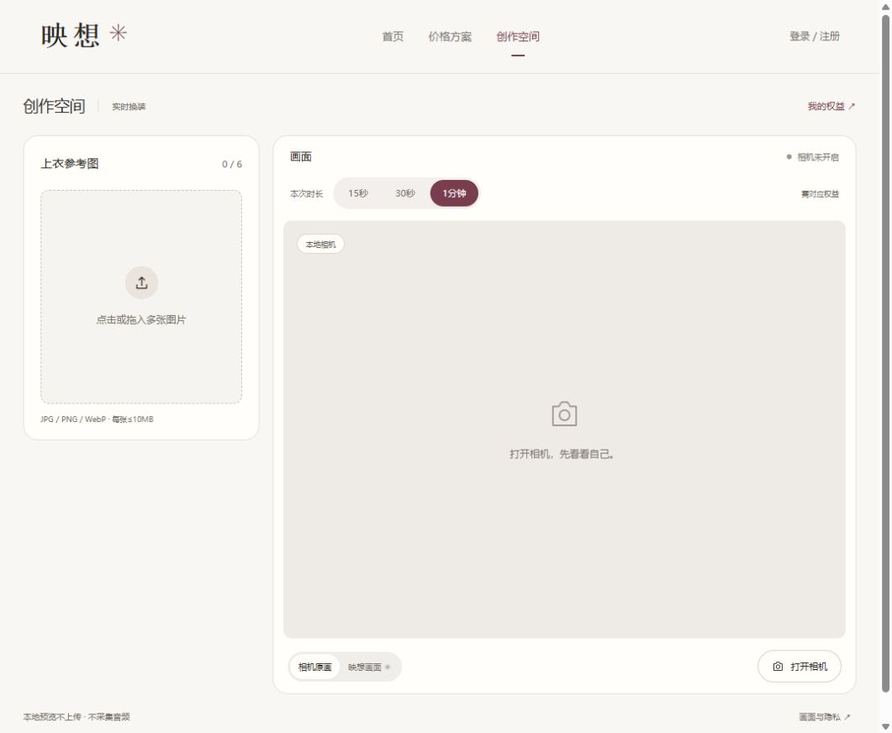

# 三档时长与双层控制验收

日期：2026-10-23。关联FR05/07/09/14/16/18/21、T04/05/15/17/18/21及ADR016。

## 现有机制核对

改动前代码同时设置15秒前端窗口和供应商令牌constraints.realtime.maxSessionDuration=15；不是模型只支持15秒。前端从connecting阶段开始计时，到期断开云端并保留独立原画。expiresIn=10仅是凭据用于新建连接的有效期，不是已建立会话长度。

[官方Client Tokens文档](https://docs.platform.decart.ai/getting-started/client-tokens)说明令牌过期不终止已建立的实时连接；maxSessionDuration限制每个WebSocket会话，最小10秒。[Create Client Token](https://docs.platform.decart.ai/api-reference/create-client-token)提供对应字段。本轮查阅日期同上；文档说明与本项目实际供应商强制断流测试分开记录。

## 本次交付

- 时长白名单为15/30/60秒，界面显示15秒、30秒、1分钟；创作页选择、价目、个人中心权益和使用记录同步。
- 连接前可选择，活动中锁定；前端截止、token请求、后端供应商上限、返回确认时长及操作记录一致。换衣、切视图均不续时或另签令牌。
- 免费及旧手工quotas仅对应15秒；30/60秒由服务端durationQuotas独立发放总次数。原子按档消费，未知仍占同档，不能用免费次数改参取得长时，不允许客户端注册/发放额度。
- 旧请求缺省15秒、旧历史缺省15秒，不恢复已用免费次数。实际账号、配额及历史未手工调整；支付保持禁用，没有自动开通长时测试权益。
- 时长仍是含连接准备的窗口，不承诺等长生成视频；供应商与客户端时钟起点可能不同。单连接上限不等于累计5美元账单硬上限。

## 实际验证

| 检查 | 结果 |
| --- | --- |
| npm run check | 类型、84项测试及生产构建通过 |
| 新增回归 | 8项，覆盖三档截止/活动不可改档/换图不续时、客户端duration传递与响应不一致拒绝、供应商请求与记录一致、非法档位/额外字段拒绝、按档并发消费与跨用户隔离、未知/重启保持、旧记录与非法配额兼容 |
| 既有回归 | 原配额、媒体克隆与清理、衣橱、令牌、来源、账户和价格回归继续通过 |
| npm run smoke | 四页200、15个生产资源、公开三档配置、旧接口关闭、文件保护、无来源403及未登录401通过 |
| IAB创作页 | 默认15秒，依次选30秒、1分钟，描边及“需对应权益”提示正确，没有打开相机或建立连接 |
| IAB价目 | 仅三档；1分钟×10次报价¥209.00、总计600秒，购买禁用 |
| 320×800 | 创作与价格页文档宽305、视口宽320，无横向溢出；随后恢复视口 |

本轮测试使用临时目录与供应商替身，不调用真实模型或改变真实使用次数。补充账户测试时曾使用错误工作目录，随后改为正确路径并执行完整84项检查通过；smoke也在frontend目录重新执行通过。

## 截图与遗留

截图为相机未开启状态，不含真实影像。没有真实验证30秒/1分钟出画、供应商强制断开时点、实际计费或账单；这些须在明确预算及停止条件下补验。原相机硬件复验与连续三图效果依赖继续保留。

未暂存、未提交、未推送、未公开部署。长时文件配置与维护边界见07第16节，真实支付仍须订单、渠道、验签及权益流水实现。
