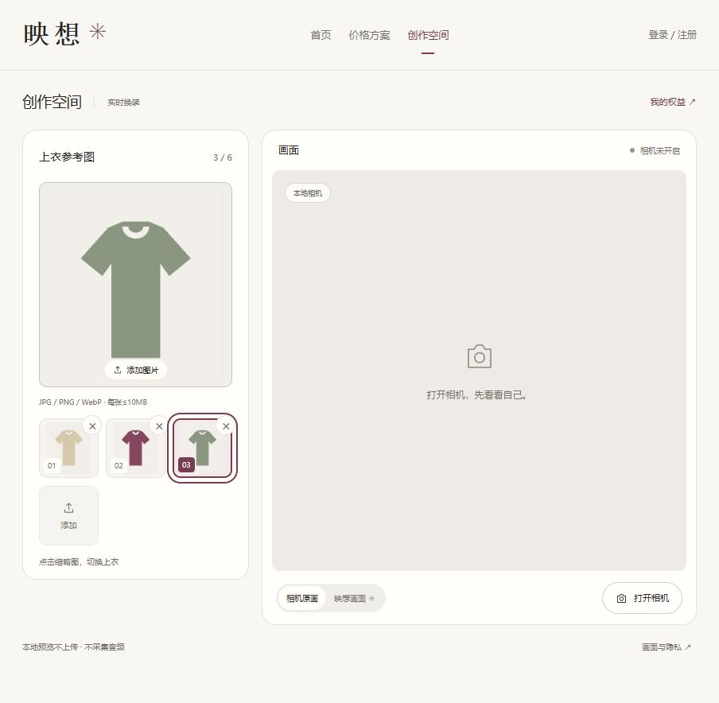

# 多图衣橱与会话换衣验收

日期：2026-10-23。关联主文档FR01/02/05/19/20、NFR06/07、T02/04/19/20及ADR015。

## 行为

创作空间支持多选/拖入多张图片、追加导入，当前页面最多6张、每张仍≤10MB，沿用原解码/像素限制及去元数据重编码。一次导入默认选首张，追加不切换，缩略图以莓果红标识当前参考图；点图或键盘激活选择另一件。移除非选中图不更新模型，移除当前图切相邻图，最后一张移除才结束生成。刷新或离开不保存衣橱。

现有会话内换图使用串行完整状态set并合并等待中的选择，不新建连接、不另签令牌或占用次数，不延长原15秒截止时间；连接中换图在就绪后应用最新选择。未开始生成时导入及点图仅本地操作。模型仍每次使用一张参考图，只有选中的图随显式开始或现有连接的换图操作发送。选中/提交不表示真实画面已经完成切换。

官方依据：[VTON模型页](https://platform.decart.ai/models/lucy-vton)说明同一实时会话可set更新服装、set替换完整状态。实际保持SDK0.2.12、lucy-vton-3.6及原prompt不变。

## 实际验证

- npm run check通过：类型检查、76项测试、生产构建。
- 新增4项图片集合回归与1项衣橱到会话集成回归；覆盖部分失败、追加不切换、6张解码前限制、重复点选、相邻选择、URL释放、取消批次丢弃及三图复用单连接/期限。原快速换图合并、建连中换图、截止及迟到更新测试继续通过。
- npm run smoke通过：四页、15个生产资源、旧入口及文件保护、未登录签发401、无来源403；没有执行有效令牌签发。
- IAB多选窗口multiple=true，一次导入3张，默认首张；点击第二张、Enter选择第三张均更新描边和大图。移除非选中图保留选择，移除选中图切相邻图；追加两张保留已有选择。
- 320×800视口三列缩略图和移除按钮可用，文档宽305、视口320，无横向溢出，测试后恢复视口。

首次测试有一项旧错误文案断言未包含新增文件名，按批量错误定位规则更新断言后完整检查76项通过。没有修改图片安全校验或放宽边界。

## 证据与限制

截图的衣服图是本机合成测试素材，仅验证上传和交互，不是模型出画。素材仅留在被忽略的frontend/.cache/wardrobe-ui-fixtures，本轮未打开相机、未调用模型，不消耗新增体验次数。真实模型连续三件换装、更新耗时和视觉稳定性尚未复验；既有一次单图成功不能替代本项验收。

账号、手工配额与历史记录未修改。没有增加媒体持久化、支付或部署；未暂存、提交、推送。
