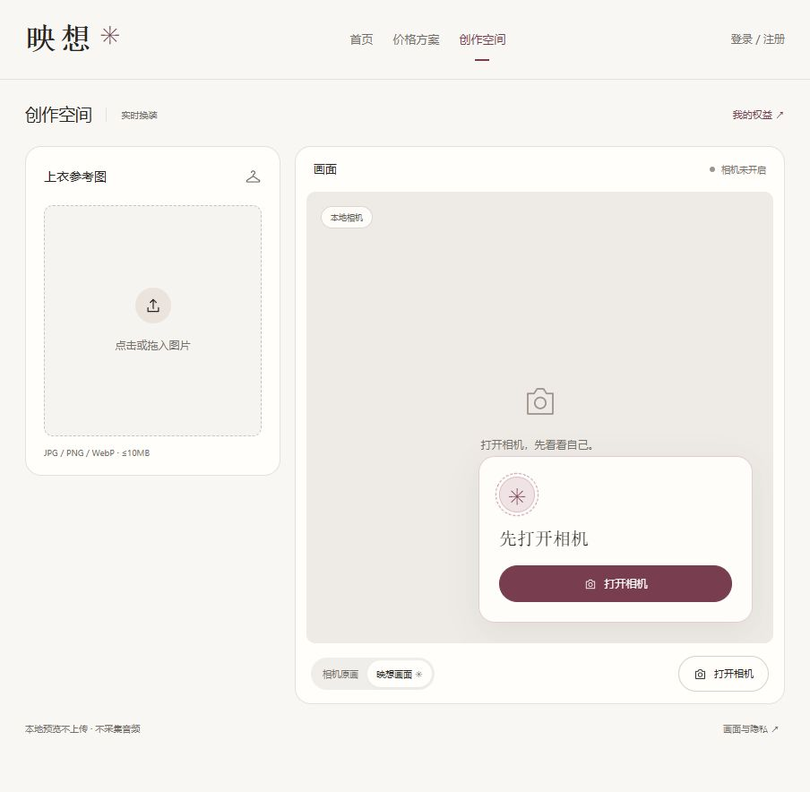

# 相机预览与换装交互验收

日期：2026-10-23。关联FR03/04/06/07/09/10/13/19、T03/04/06/10/12/13/19，主设计文档第22节及ADR014。

## 交付范围

- 创作页去除大标语、宣传说明、权益横条、人台示意及重复操作说明；保留选图、画面、控件和必要状态，完整媒体说明进入隐私弹窗。
- 访客可不选图、不登录、不确认云端处理而主动开启本地相机。该步骤不签发模型令牌、不占用体验次数。
- 点击“映想画面”仅切换视图，并在相机画面上浮出带动效的操作卡；依次引导打开相机、选择图片、确认云端处理、登录和显式开始。切换视图或登录成功不会自动生成。
- 真实换装复用已就绪原画的克隆流。结束、超时、连接失败仅清理模型输入与远端；关闭相机、退出或换账号、后台、离页和卸载清理全部媒体。
- 云端告知版本更新为2026-10-23-preview-cloud-v2。模型、SDK、提示模板、15秒连接窗口及现有手工测试账号配额不变。

## 实际验证

| 检查 | 结果及边界 |
| --- | --- |
| npm run check | 类型检查、71项自动化测试、Next.js生产构建通过 |
| 新增媒体回归 | 4项独立预览生命周期及4项共享原画适配器测试通过；覆盖显式启动、重复启动、取消后的迟到授权、拒权恢复、设备结束、无预览不签发、克隆清理、令牌失败及迟到SDK结果 |
| 既有回归 | 图片、会话、同源/令牌、用户与手工配额、价格等原有测试保持通过 |
| npm run smoke | 四页200、15个生产资源、拟定价格禁购买、旧入口404、文件路径不可访问、无Origin签发403、同源未登录签发401通过 |
| 浏览器交互 | IAB确认默认原画、点击映想显示动画悬浮卡、切回原画隐藏卡、隐私弹窗打开关闭；未登录且无图片时仍可点击本地打开相机 |
| 320×800布局 | 控件换行可用，文档宽305、视口宽320，无横向溢出；浮卡与相机控件可见，测试后恢复视口 |
| 真实相机 | 尝试后页面提示相机可能被占用或系统隐私设置关闭；没有取得真实原画，不能判定具体占用程序 |
| 真实模型 | 本轮未签发或连接模型，未上传媒体、不消耗新增测试次数；没有进行真实换装复验 |

测试替身证明克隆输入与清理分支符合预期，不等于真实浏览器及供应商端已经验收。保留原画时，观察记录localTracksEnded为false是预期状态，不能据此判断模型是否继续计费；供应商账单仍以其实际记录为准。

## 截图

下图为未开启相机、未选图的映想悬浮卡状态，不含真实用户影像。

## 遗留与交付状态

硬件可用后需补验真实原画、共享克隆接入、结束换装保留预览，以及关相机/后台时全部关闭。真实模型复验仍遵循已有预算及明确停止条件，本轮不自动追加。

账号数据、手工配额、历史体验与费用记录未改动。本轮代码及文档留在工作区，未暂存、未提交、未推送、未公开部署。
