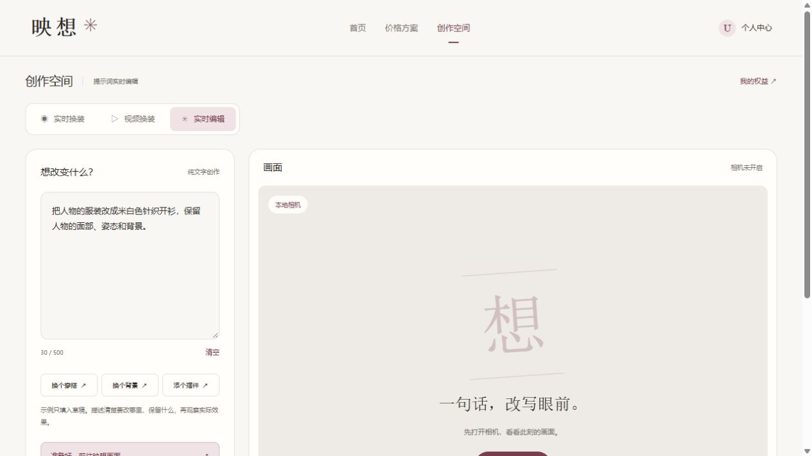

# FastAPI与SQLite架构迁移验收

日期：2026-10-24。状态：**本机架构迁移与切流完成，扩展运维/性能及真实模型验收仍有留项**。用户授权按13实施迁移，随后补充“SQL版本怎么方便怎么来”；本轮不自动提交、推送或公开部署。

关联FR09/10/11/13—16/18/21/23/24、NFR06—09、T14—18/21/23/24/25/26。保留六页及既有浏览器媒体流程，覆盖匿名、登录/退出、本人权益/订单、unknown、关闭场景、维护与后端不可用状态。

## 结果与运行版本

Next.js/React页面、浏览器SDK0.2.12和媒体生命周期保留；业务API全部迁入FastAPI，SQLAlchemy/Alembic管理SQLite。Next仅有 `/api/[...path]` 同源转发，旧17个业务路由、7个Node服务模块及Node Stripe依赖已移除。旧JSON保留归档，不再参与运行读写。

| 项目 | 实际版本/配置 |
| --- | --- |
| 运行时 | CPython3.13.17，python.org官方Windows x64安装器；安装器签名Valid，签名者Python Software Foundation；隔离安装到backend/.runtime |
| SQLite | 3.50.4；DELETE/FULL、foreign_keys=ON、busy_timeout=1000ms，关键写事务BEGIN IMMEDIATE |
| API/校验 | FastAPI0.161.1、Pydantic2.14.1、Uvicorn0.54.0、单worker、回环8788 |
| 数据迁移 | SQLAlchemy2.1.6、Alembic1.20.1、revision0001 |
| HTTP/支付 | HTTPX0.28.1、stripe-python16.0.0、API2026-09-30.endive |
| 测试/解析 | pytest9.1.1、python-multipart0.0.32；完整直接/间接依赖及哈希在requirements.lock.txt |
| 前端 | 原Next.js16.4.2、React19.3.1、TypeScript5.9.3，回环8787 |

遵从用户补充，直接采用现成SQLite，使用DELETE避开该版本WAL-reset问题；不再要求为本次迁移升级SQLite。WAL仍只允许明确修复运行时，未来切换需回归。代价是读写并发受限，本轮未宣称生产容量达标。详见04的ADR021与[SQLite官方说明](https://www.sqlite.org/wal.html)。

## 实现与兼容

- 旧scrypt参数、salt字符串UTF-8字节、UTF-16密码长度及未配对代理项编码均有Node固定样本；会话hash仍对64位token字符串做SHA256，保留原到期时间。未输入或重置真实用户密码。
- 保留原Cookie名称/HttpOnly/Lax/Path/7天及同源Origin、sec-fetch-site边界；不信任X-Forwarded-*。失败登录计数独立提交，密码计算在事务外线程池执行。
- 注册、一次免费grant/流水和会话同事务；真实使用和stripe_sandbox隔离，按档原子预留。签发前落unknown，网络失败或进程中断不退回、不重提；观测不能返次数。模型/模板/TTL10秒及15/30/60秒约束不变。
- 固定9个SKU、整数人民币分、Checkout原参数和幂等key；新订单保存请求快照。订单状态、事件去重、一次grant/流水同事务，写入失败不会先标processed。
- 老JSON未保存未知Checkout原Origin/请求快照；导入器遇到creating且无Session的订单会阻止导入，需人工核对，不能猜参数换key。本次源没有该类订单。
- 提示词/视频使用独立整数microUSD预留和租约，未知/失败/到期不自动返还。视频通过有界内存multipart回调解析，不使用UploadFile/临时文件；保留MP4/图像签名及时间表复核。结果鉴权流转发，取消/异常关闭上游。
- 转发层使用Node原生HTTP：隔离测试发现Fetch会重写Host，现已修复；白名单转发Host、Cookie、Origin、原始体和下载流，不转发客户端伪造的代理头，不自动跟随重定向或回退旧端。HEAD/OPTIONS亦复刻Next原自动方法；禁尾斜杠自动跳转。
- 长期密钥迁到backend/.env；原前端配置完整保存在私有最终快照。前端配置仅保留页面/Node配置和回环API目标。

## 导入、切流与数据核对

先在旧运行数据只读副本上演练；无差异后停止原8787 Next进程、检查锁为空，再创建最终停写快照。业务源7个文件指纹为 `f96d705c4d6c393efcc79fa21d92ca8bf6218309627d48ed8ee0b4f3bccad98f`，与演练及切换后的旧源一致。旧PoC及配置另完整保存在私有快照，不转为可消费权益。

| 导入对象 | 实际计数/结果 |
| --- | --- |
| 用户/会话 | 3个用户、3条原会话；UUID、凭据摘要、盐、到期不变 |
| 实时使用/签发 | 2条，按attemptId合并，不重复扣次；缺省时长按15秒 |
| 订单/事件 | 4单、4条原事件；3 paid、1 expired；不虚构旧事件归属 |
| 沙盒权益 | 从原fulfilled订单逐单生成唯一grant，与旧聚合精确一致；不额外赠送 |
| 提示词 | 1条issued、$0.30原预留及原lease保留；开关仍关闭 |
| 视频 | 0任务；开关仍关闭 |
| 配额/限流/访问nonce | 总量、按档余额/占用、限流和原nonce保留；quotas不叠加默认一次 |

导入事务内查询核对每用户每档total/reserved/used、凭据/会话、订单状态/金额/Session/fulfilled、事件集合和场景预算/租约；未知字段、孤立数据、超用/聚合冲突、残锁、重复身份均拒绝并回滚。导入指纹/版本/摘要/清单写migration_imports，二次导入不增减权益。

实际库 `backend/data/yingxiang.sqlite3`；最终快照 `backend/data/final-20261024/`；首次备份 `backend/backups/initial-20261024.sqlite3`。均被Git忽略，不包含在交付差异中。恢复到新文件后，13张业务表与当前库逐行一致，integrity_check和foreign_key_check通过；原JSON指纹不变。快照/备份在本机敏感目录，未上传。

先以维护模式启动新后端，匿名状态/本人模块基础读取可用，Webhook/写请求503而不吞通知；readiness确认库/revision/PRAGMA后再退出维护。随后原8787入口切为新转发，当前8787/8788均运行。只有FastAPI写业务库；新库写入后禁止直接回旧JSON，按手册维护并向前修复。

## 实际验证

| 检查 | 实际结果 |
| --- | --- |
| 迁移前参照 | 原114项Node测试、类型与生产构建通过；只作为旧实现基线 |
| 后端依赖 | 按哈希锁安装；第二个干净venv重新安装并跑通当时26项；pip check通过 |
| 后端pytest最终回归 | 43项；临时文件库、Node凭据样本、29个旧路由HTTP样本、限流、三档权益/错误权限/TTL、两连接/两进程争用、进程中途退出、支付写入故障原子回滚、重复导入/坏源/未知创建拒绝、备份恢复及内存媒体等 |
| 前端 | OpenAPI类型漂移检查、类型检查、63项媒体/会话/图片/价格回归及生产构建通过；后端专项已迁pytest，无机械保留原测试总数 |
| 隔离双进程 | 8789页面→8790供应商替身；Cookie/Origin/尾斜杠/方法、模型替身签发、12821467字节MP4上传、9秒识别及下载原字节通过 |
| 本地Webhook | 真Stripe SDK验证原字节签名，篡改拒绝，2次同签名重放仍只发一次，沙盒不增真实次数 |
| 当前运行smoke | 六页、22个生产资源、API配置/旧接口503、非公开文件404、账号/模型来源与鉴权、视频/提示词隔离通过；另实停FastAPI，确认前端API返回503且不回退旧仓储，再恢复服务 |
| 真实Stripe只读核对 | 新Python SDK执行账户GET1次、既有Session GET4次；原账户/金额/币种/用户归属/非live/状态均匹配。无新Checkout、付款或退款请求，未改变原订单 |
| 浏览器IAB | 隔离页面三模式导航、准备提示词草稿、登录后保留且未发送、个人中心/一次免费权益/退出通过；未开相机/连接模型 |
| 恢复/旧源 | 初始真实备份恢复到新文件后13张业务表一致；旧源指纹不变，源码/私有配置与Git忽略检查另行完成 |

主要命令：backend/ 的 `python -m pytest`、`pip check`、`scripts.ops snapshot/dry-run/init/import/check/backup/restore/openapi`；frontend/ 的 `npm run check`、`npm run smoke`、`node scripts/migration-integration.mjs`。测试中的用户、token/key和签名均为明确合成样本；真实密钥未进入命令参数或输出。CLI异常不输出源对象/SQL参数。

## 留项与边界

本机迁移完成，不等于全部NFR或发布验收完成：本轮未重测320px、Safari/真机、键盘/读屏完整流程或实际相机；页面布局未重做。也未执行真实AI、长时断流/账单/效果回归，原提示词失败结论保留。

未实注满盘/硬断电/只读卷全部组合，未做生产P95/上传内存容量或长时间压测；已验证锁超时、缺库、约束、人工触发支付事务失败与进程退出。SQLite单机和单worker边界保留，生产部署/HTTPS网关/自动备份调度/异机加密/RPO/RTO仍待落实，不将通用框架数据写成本项目容量。

pytest存在Starlette TestClient对HTTPX的弃用提示，当前固定组合仍43项通过；后续升级测试客户端单独回归，不在本次顺便升级业务HTTP。真实Stripe沙盒回调经新链路的签名/查单已由本地重放及5次只读GET分别验证，但没有新建真实沙盒付款进行第二轮用户端端到端测试。

正式支付、商户资格、退款/争议、短信/找回密码和公开上线仍未完成。旧文件长期归档与备份留存策略尚未自动化，禁止删除这些记录来重置配额或预算。

本轮未暂存、提交或推送；待用户审核后才能按功能分批提交。
